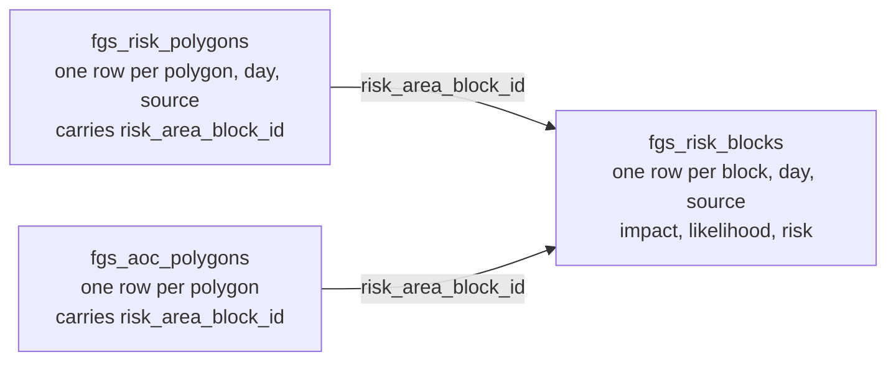
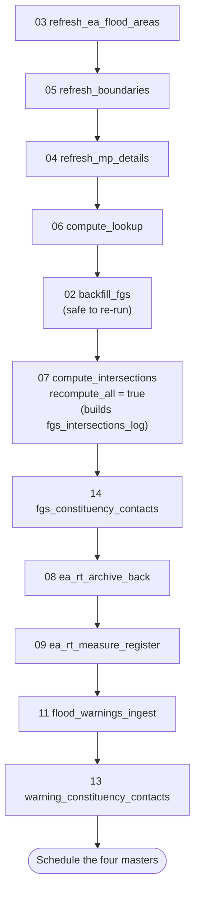
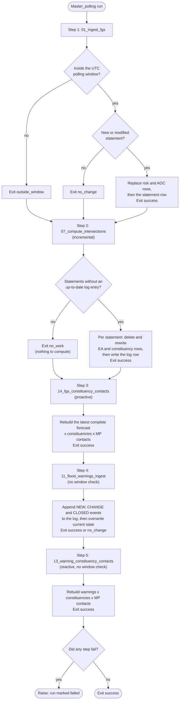
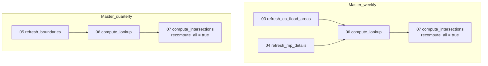
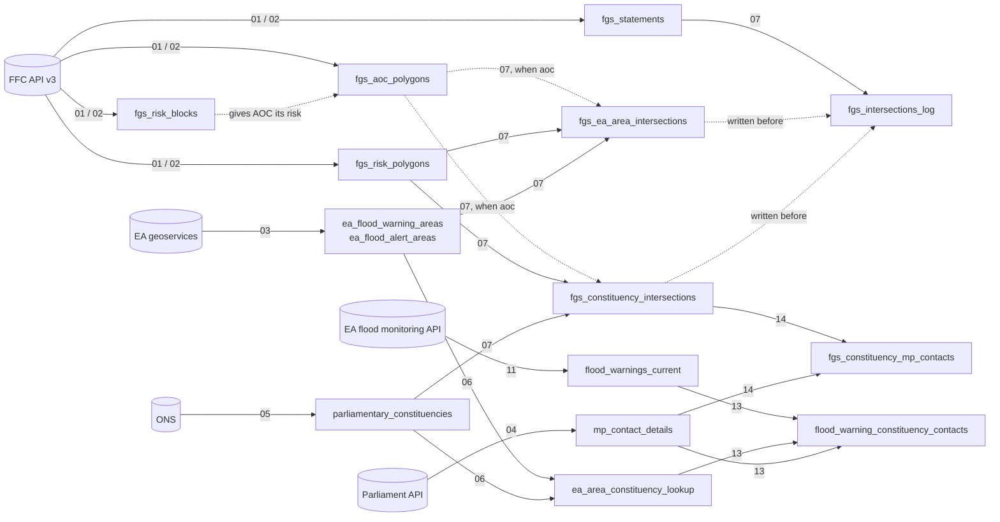

# FGS Pipeline -- DASH / Databricks

Ingests the Flood Guidance Statement from the FFC API v3, stores it as a
queryable Delta Lake history, and maintains a set of spatial intersection
tables linking FGS risk geometries to EA flood areas and parliamentary
constituencies. It also lands EA real-time flood warnings and river readings.

---

## Before you start

### 1. Provide the FFC API key

`config.get_ffc_api_key()` looks for the key in this order and uses the first it
finds:

1. **A Databricks secret** (preferred, if you can create a scope). Run once from
   the Databricks CLI on your local machine:

   ```bash
   databricks secrets create-scope fgs-pipeline
   databricks secrets put-secret fgs-pipeline ffc-api-key
   # Paste your FFC API key when prompted
   ```

2. **The `FFC_API_KEY` environment variable.**
3. **A `.env` file** next to `config.py`, with a line `FFC_API_KEY=your-key`.
   `.env` is in `.gitignore`, so it is never committed. If your existing `.env` is
   in your Git folder, there is nothing to change. If you clone the repo into a new
   folder, copy it across, or point `FGS_ENV_FILE` at its path. `python-dotenv` is
   not needed.

A `.env` file is plain text, so anyone who can open that folder can read the key. A
secret scope is the safer home for it if your permissions allow. To request a key,
email ffcenquiries@environment-agency.gov.uk (see the FGS Public API documentation).

### 2. Check config.py

- `CATALOG` and `SCHEMA` -- where the tables live (currently
  `prd_dash_lab.flood_forecasting_unrestricted`).
- `SECRET_SCOPE` and `SECRET_KEY` -- only if you used different names for the secret.
- `POLL_START_HOUR` / `POLL_END_HOUR` -- the polling window, in UTC.

Everything else can be left as is unless an external URL changes.

### 3. Deploy to the Databricks workspace

Clone the repo into a Databricks Git folder (or upload it). Notebooks locate the
project root from their own path and call each other by relative path, so the
folder can sit anywhere. Nothing refers to one person's workspace folder.

### 4. First-time run order

1. `jobs/03_refresh_ea_flood_areas`
2. `jobs/05_refresh_boundaries`
3. `jobs/04_refresh_mp_details`
4. `jobs/06_compute_lookup`
5. `jobs/02_backfill_fgs` -- seeds the full statement history. Safe to re-run.
   Re-run it on an existing install to add `fgs_risk_blocks` and the AOC block ids.
   The history is large (thousands of statements, 50 per page), and a page can
   time out. Each page is saved before the next is fetched, so nothing is lost. If
   it fails, the output says which page to resume from: set the widget
   `start_page` to that number (keep `page_size` the same) and run again.
   `timeout_seconds` (default 120) can be raised for a slow page. Re-running is
   always safe.
6. `jobs/07_compute_intersections` with widget `recompute_all` = `true`. This
   builds `fgs_intersections_log`. Do this before scheduling the polling master,
   otherwise its first run tries to process the whole history inside a 10 minute
   timeout.
7. For EA real-time data: `jobs/08_ea_rt_archive_back`, then
   `jobs/09_ea_rt_measure_register`.
8. `jobs/14_fgs_constituency_contacts`. It needs the intersections (6) and the MP
   table (3).
9. `jobs/11_flood_warnings_ingest`, then `jobs/13_warning_constituency_contacts`.
   Step 13 needs the lookup (4), the MP table (3) and the current warnings (this
   step), so it is last.
10. Schedule the masters (see `workflows/scheduling_guide.md`).

### Starting over on an existing install

If the tables were built by an earlier version of this pipeline, the simplest and
safest route is to rebuild the FGS-derived tables from the API. The FFC backfill
recreates the whole statement history, so nothing is lost.

**Keep** these. They cannot be recreated:

- `flood_warnings_log`. The EA API only returns current state, so deleted events
  are gone for good.
- `ea_rt_readings_bronze`. It grows daily, and the archive only reaches back 30
  days, so dropping it loses anything older.
- `ea_rt_measure_register` is compatible and costs about 15 minutes of API calls to
  rebuild, so there is no reason to drop it.

**Drop** the FGS-derived tables, then clear the live warnings state (not the log):

```sql
DROP TABLE IF EXISTS prd_dash_lab.flood_forecasting_unrestricted.fgs_statements;
DROP TABLE IF EXISTS prd_dash_lab.flood_forecasting_unrestricted.fgs_risk_polygons;
DROP TABLE IF EXISTS prd_dash_lab.flood_forecasting_unrestricted.fgs_aoc_polygons;
DROP TABLE IF EXISTS prd_dash_lab.flood_forecasting_unrestricted.fgs_risk_blocks;
DROP TABLE IF EXISTS prd_dash_lab.flood_forecasting_unrestricted.fgs_ea_area_intersections;
DROP TABLE IF EXISTS prd_dash_lab.flood_forecasting_unrestricted.fgs_constituency_intersections;
DROP TABLE IF EXISTS prd_dash_lab.flood_forecasting_unrestricted.fgs_intersections_log;
DROP TABLE IF EXISTS prd_dash_lab.flood_forecasting_unrestricted.fgs_constituency_mp_contacts;
DROP TABLE IF EXISTS prd_dash_lab.flood_forecasting_unrestricted.flood_warning_constituency_contacts;
DROP TABLE IF EXISTS prd_dash_lab.flood_forecasting_unrestricted.ea_area_constituency_lookup;

-- Clear the live state so the first run does not log a CLOSED event for every
-- stale warning left over from the old workflow. Do NOT clear flood_warnings_log.
DELETE FROM prd_dash_lab.flood_forecasting_unrestricted.flood_warnings_current;
```

The EA areas, constituencies and MP tables are overwritten in full by their jobs, so
they do not need dropping. Pause every old schedule first. Then follow the first-time
run order below, skipping `08` and `09` because the bronze and register tables
already exist. Run `Master_polling` once by hand before scheduling the masters.

### 5. Scheduling

Schedule the four master notebooks with the Databricks notebook scheduler (see
`workflows/scheduling_guide.md`), **or** deploy `workflows/databricks_workflows.yml`
as a bundle (`databricks.yml`) if you have Workflows permissions. Use one or the
other, never both.

---

## Table inventory

| Table | Refresh | Description |
|---|---|---|
| `fgs_statements` | Per FGS issue or modification | One row per statement. Replaced if the statement is modified. |
| `fgs_risk_polygons` | Per FGS issue or modification | One row per geometry per source per day. `geometry_type` is `Polygon` or `LineString` (coastal polylines). |
| `fgs_aoc_polygons` | Per FGS issue or modification | Area of Concern geometries, one row per polygon. Each carries `risk_area_block_id`, its link to `fgs_risk_blocks`. |
| `fgs_risk_blocks` | Per FGS issue or modification | One row per risk area block, forecast day and flood source (impact, likelihood, risk). No geometry. The link between `fgs_risk_polygons` and `fgs_aoc_polygons`. |
| `ea_flood_warning_areas` | Weekly | EA Flood Warning Areas. |
| `ea_flood_alert_areas` | Weekly | EA Flood Alert Areas. |
| `parliamentary_constituencies` | Quarterly | ONS constituency boundaries. |
| `mp_contact_details` | Weekly | Current MPs and contact details. |
| `ea_area_constituency_lookup` | Weekly / quarterly | Static spatial join: EA areas to constituencies (real overlaps only). |
| `fgs_ea_area_intersections` | Per FGS issue | FGS geometries (from the source chosen in `FGS_GEOMETRY_SOURCE`, tagged `geometry_source`) intersecting EA areas. Polygons need 25% coverage of the EA area; lines (coastal) have `intersection_pct` NULL. |
| `fgs_constituency_intersections` | Per FGS issue | FGS geometries intersecting constituencies (any real overlap), tagged `geometry_source`. |
| `fgs_intersections_log` | Per FGS issue | One row per statement and `geometry_source` once intersected, with the `last_modified_at` it was computed at. |
| `ea_rt_readings_bronze` | Daily | EA real-time readings, partitioned by `reading_date`. |
| `ea_rt_measure_register` | Daily (new measures) | One row per measure, enriched from the station API. |
| `flood_warnings_current` | Every poll | Live state of EA flood warnings and alerts. |
| `flood_warnings_log` | Every poll | Append-only log of NEW / SEVERITY_CHANGE / MESSAGE_CHANGE / CLOSED events. |
| `fgs_constituency_mp_contacts` | Every poll | The latest complete FGS forecast (proactive): one row per geometry, day, source and constituency, with the sitting MP and contact details. |
| `flood_warning_constituency_contacts` | Every poll | Current warnings and alerts, one row per constituency each overlaps, with the sitting MP and contact details. |
| `ea_administrative_areas` | Manual | EA and Natural England administrative boundaries. |
| `ea_rt_stations` | Manual (15) | Every EA real-time station, one row per station, from the stations API. |
| `ea_rt_station_measures` | Manual (15) | One row per measure, keyed by `stationReference`. |
| `ea_rt_wiski_lookup` | Manual (16) | Measures matched to WISKI ids from the externally supplied lookup CSV. |
| `ea_thresholds_all` | Manual (17) | Flood thresholds from the restricted volume. Lives in the restricted schema, `flood_forecasting_restricted`. |

### Risk matrix labels

`risk_x` is impact and `risk_y` is likelihood, as in the FGS Public API
documentation:

| Value | Impact (`risk_x`) | Likelihood (`risk_y`) |
|---|---|---|
| 1 | Minor | Low (10-25%) |
| 2 | Moderate | Medium (25-50%) |
| 3 | Significant | High (50-75%) |
| 4 | Extreme | Very High (>75%) |

`risk_level` and `risk_colour` come from the FGS User Guide matrix in
`utils/helpers.py` (`RISK_MATRIX`). The API documentation gives positions only,
so check that table against the published guide.

---

## Choosing the FGS geometry source: risk areas or AOC

The FGS carries two sets of shapes. The **risk area polygons** (`fgs_risk_polygons`)
define the spatial extent of each risk. The **Area of Concern (AOC) map polygons**
(`fgs_aoc_polygons`) are the detailed map section of the statement. Both are always
ingested and kept. One setting in `config.py` decides which the intersections and
the FGS contact table are built from:

```python
FGS_GEOMETRY_SOURCE = "risk_areas"   # or "aoc"
```

### How the two link

Per the FFC API v3 documentation, every AOC polygon points at a risk area block
with `risk_area_block_id`, and that block gives the flood source, the forecast days
and the impact and likelihood. The pipeline stores the block definitions in
`fgs_risk_blocks`, so an AOC polygon takes its risk from its block:



```sql
-- Each AOC polygon with the risk it inherits from its block
SELECT a.statement_id, a.poly_id AS aoc_poly_id, a.risk_area_block_id,
       b.day_index, b.forecast_date, b.source, b.risk_level, b.risk_colour
FROM prd_dash_lab.flood_forecasting_unrestricted.fgs_aoc_polygons a
JOIN prd_dash_lab.flood_forecasting_unrestricted.fgs_risk_blocks b
  ON  b.statement_id       = a.statement_id
  AND b.risk_area_block_id = a.risk_area_block_id;
```

An AOC polygon appears once per day and source of its block, the same way a risk
polygon does. This link comes from the API documentation, not from live data, so
check it (below) before relying on `"aoc"`.

### What each setting does

| | `"risk_areas"` (default) | `"aoc"` |
|---|---|---|
| Shapes intersected | `fgs_risk_polygons` | `fgs_aoc_polygons` |
| Flood source, day, risk from | the polygon row itself | its block in `fgs_risk_blocks` |
| `poly_id` in the output | the risk polygon id | the AOC polygon id |
| `geometry_source` in the output | `risk_areas` | `aoc` |

Intersection rows are tagged with `geometry_source` and the log is kept per source,
so the two sets **sit side by side in the same tables**. Recomputing one source
replaces only that source's rows and never deletes the other. Rows written before
the tag existed count as `risk_areas`. `fgs_constituency_mp_contacts` (job 14)
follows the same setting.

### Switching, and bringing existing data up to date

1. **Once, now:** re-run `jobs/02_backfill_fgs`. It is safe to re-run. It writes
   `fgs_risk_blocks` and adds `risk_area_block_id` to the existing AOC rows, which
   were stored without it.
2. Set `FGS_GEOMETRY_SOURCE` in `config.py`.
3. Run `jobs/07_compute_intersections` with widget `recompute_all` = `true`. Do this
   by hand; it covers the whole history for the chosen source. Then run
   `jobs/14_fgs_constituency_contacts`.
4. The polling master carries on with the chosen source.

### Check the link before choosing AOC

```sql
-- 1. Do AOC polygons carry a block id, and do those blocks exist?
SELECT COUNT(*)                                             AS aoc_polygons,
       COUNT(a.risk_area_block_id)                          AS with_block_id,
       COUNT(DISTINCT CASE WHEN b.risk_area_block_id IS NOT NULL
                           THEN a.statement_id || '-' || a.poly_id END) AS linked_to_a_block
FROM prd_dash_lab.flood_forecasting_unrestricted.fgs_aoc_polygons a
LEFT JOIN (SELECT DISTINCT statement_id, risk_area_block_id
           FROM prd_dash_lab.flood_forecasting_unrestricted.fgs_risk_blocks) b
  ON b.statement_id = a.statement_id AND b.risk_area_block_id = a.risk_area_block_id;

-- 2. Which source is each intersection table holding?
SELECT COALESCE(geometry_source, 'risk_areas') AS geometry_source, COUNT(*)
FROM prd_dash_lab.flood_forecasting_unrestricted.fgs_constituency_intersections
GROUP BY 1;
```

If `with_block_id` is zero after the re-run, the API does not return
`risk_area_block_id` on AOC polygons. AOC shapes then cannot be given a risk, and
job 07 fails with a message saying so. Stay on `"risk_areas"` and tell me what the
API does return.

## Order of processing

### First-time setup

Run these by hand, once, in this order. Steps 1 to 4 load the reference data the
intersections depend on. Step 6 must finish before the polling master is
scheduled.



### Polling (Master_polling, every 30 or 60 minutes)

Every step runs on every poll. A failure is recorded and the later steps still
run, then the notebook raises at the end so the run is marked as failed. The
exit values (`outside_window`, `no_change`, `no_work`) are normal outcomes, not
failures.



### Daily (Master_daily, 23:00 UTC)


### Weekly (Sunday 02:00 UTC) and quarterly (or after an election)



In the workflow definition the two weekly refreshes run in parallel. In
`Master_weekly` they run one after the other.

### How the tables are built



There are two contact tables, one for each way of looking at flood risk.
`fgs_constituency_mp_contacts` is proactive: it starts from the forecast (the
FGS), so an MP can be told before any warning exists.
`flood_warning_constituency_contacts` is reactive: it starts from warnings the EA
has already issued (`11`), through the spatial lookup (`06`). Both end at the
sitting MP (`04`). The
other EA real-time tables are separate: `10` lands `ea_rt_readings_bronze`, `09`
builds `ea_rt_measure_register` from it, and `11` also appends to
`flood_warnings_log`.

### How re-runs stay safe

- A statement is identified by `statement_id` and `last_modified_at`. A modified
  statement is ingested again and its old rows are **replaced**, never
  duplicated.
- Child tables are written first and `fgs_statements` last, so a failure part
  way through is retried in full on the next poll.
- `14_fgs_constituency_contacts` and `13_warning_constituency_contacts` rebuild
  their tables in full on every poll, so each always matches the current forecast
  or the current warnings. History is in the FGS tables and `flood_warnings_log`.
- `07_compute_intersections` deletes a statement's rows before writing them and
  records the statement in `fgs_intersections_log` last. `recompute_all` is
  therefore safe to run as often as you like.

---

## The forecast (FGS), by constituency and MP: proactive

`fgs_constituency_mp_contacts` holds the latest statement whose intersections are
complete. It is the forecast for the next five days, so it shows where flooding is
possible before any warning is issued. The grain is one row per FGS geometry,
forecast day, flood source and constituency, so a constituency usually has several
rows a day. Rank them to get the worst risk.

```sql
-- MPs whose constituency has an Amber or Red risk in the forecast, worst risk per
-- constituency, day and source.
WITH ranked AS (
    SELECT *,
           ROW_NUMBER() OVER (
               PARTITION BY constituency_id, forecast_date, source
               ORDER BY risk_rank DESC, risk_x DESC, risk_y DESC
           ) AS rn
    FROM prd_dash_lab.flood_forecasting_unrestricted.fgs_constituency_mp_contacts
)
SELECT
    forecast_date, constituency_name, source,
    risk_level, risk_colour, impact_label, likelihood_label,
    mp_name, mp_party, mp_email, mp_phone
FROM ranked
WHERE rn = 1
  AND risk_rank >= 3                    -- 3 Medium (Amber), 4 High (Red)
  AND mp_matched
ORDER BY forecast_date, risk_rank DESC, constituency_name;
```

Notes on the table:

- `risk_rank` is 1 Very Low, 2 Low, 3 Medium, 4 High, taken from `risk_level`.
- `geometry_source` says which set of FGS shapes the rows came from (`risk_areas` or
  `aoc`), as set by `FGS_GEOMETRY_SOURCE` in `config.py`. `poly_id` is an id in that
  set.
- It shows the latest statement that is fully intersected. If a newer statement
  has arrived but `07` has not finished it, the table keeps the previous complete
  one and the job output says so. `statement_id` and `issued_at` are on every row.
- `share_of_constituency_covered` is the share of the constituency the FGS
  geometry covers. Links below 1% are not written (`FGS_CONTACT_MIN_PCT` in
  `config.py`). Coastal polylines have no area, so this is NULL and they are
  always kept.
- `mp_matched = false` marks a constituency with no matching MP. The job lists
  them, and fails if no constituency matches any MP.
- Like the reactive table, it is the current picture, not history: MP details are
  overwritten weekly, so old forecasts are not re-stamped with today's MP.

## Flood warnings and alerts, by constituency and MP: reactive

`flood_warning_constituency_contacts` holds the current picture. One warning that
spans three constituencies is three rows. Every row carries the warning, the
constituency and the MP.

```sql
-- MPs with a Flood Warning or Severe Flood Warning in force in their constituency.
SELECT
    mp_name, mp_party, mp_email, mp_phone,
    constituency_name,
    flood_area_id, flood_area_name, description,
    severity_level, severity_label,
    ROUND(share_of_area_in_constituency, 2) AS share_of_area_in_constituency,
    time_severity_changed
FROM prd_dash_lab.flood_forecasting_unrestricted.flood_warning_constituency_contacts
WHERE is_in_force
  AND severity_level IN (1, 2)          -- 1 Severe Flood Warning, 2 Flood Warning
  AND mp_matched
ORDER BY severity_level, constituency_name;
```

Notes on the table:

- `is_in_force` is false for severity 4 ("Warning no Longer in Force"). Those rows
  stay so a closing warning is still visible. Severity 3 is a Flood Alert.
- `ea_area_type` says whether the area is a `flood_warning` or `flood_alert` area.
- `share_of_area_in_constituency` is the share of the warning area that lies in
  that constituency. Links below 1% are not written, so an MP is not linked to a
  warning that only clips the edge of their constituency. Change
  `WARNING_CONTACT_MIN_PCT` in `config.py` (0.0 keeps every real overlap), or
  filter on this column at query time.
- `mp_matched = false` marks a constituency with no matching MP: a vacancy, or a
  name that differs between the ONS and Parliament sources. The MP is matched on
  a normalised name (lower case, accents folded, `&` as `and`). Each run lists the
  unmatched constituencies in the job output.
- A warning that does not appear at all is not in `ea_area_constituency_lookup`.
  The job lists these. If none match, the job fails, because that means the EA
  warning codes and the area codes no longer agree.

## Typical query: which MPs need to be alerted?

```sql
-- MPs whose constituencies intersect an amber or red river risk today,
-- from the most recent statement.
SELECT DISTINCT
    mp.name               AS mp_name,
    mp.party,
    mp.email,
    mp.constituency_name,
    fi.source,
    fi.risk_colour,
    fi.risk_level,
    fi.forecast_date

FROM prd_dash_lab.flood_forecasting_unrestricted.fgs_constituency_intersections fi
JOIN prd_dash_lab.flood_forecasting_unrestricted.mp_contact_details mp
  ON fi.constituency_name = mp.constituency_name      -- joined on name: the Parliament API gives no ONS code

WHERE COALESCE(fi.geometry_source, 'risk_areas') = 'risk_areas'   -- one geometry source, or both would be counted
  AND fi.statement_id = (
        SELECT MAX(statement_id)
        FROM prd_dash_lab.flood_forecasting_unrestricted.fgs_statements)
  AND fi.forecast_date = CURRENT_DATE()
  AND fi.source        = 'river'
  AND fi.risk_colour IN ('Amber', 'Red')

ORDER BY CASE fi.risk_colour WHEN 'Red' THEN 1 ELSE 2 END, mp.constituency_name;
```

The name join can miss MPs whose constituency is spelled differently in the two
sources. Check for unmatched names after each constituency or MP refresh:

```sql
SELECT c.name
FROM prd_dash_lab.flood_forecasting_unrestricted.parliamentary_constituencies c
LEFT JOIN prd_dash_lab.flood_forecasting_unrestricted.mp_contact_details m
  ON c.name = m.constituency_name
WHERE m.member_id IS NULL;
```

---

## After a general election

Run these two jobs manually, in order, before the next polling window:

1. `05_refresh_boundaries`
2. `04_refresh_mp_details`

Then run `master_quarterly` (or `06_compute_lookup` followed by
`07_compute_intersections` with `recompute_all` = `true`).

---

## Files

```
.
├── config.py                          All settings -- edit this first
├── databricks.yml                     Asset bundle (only if you use Workflows)
├── utils/
│   ├── helpers.py                     Parsing, API access, idempotent writes
│   └── geo.py                         GeoPandas helpers (06 and 07 only)
├── jobs/
│   ├── 01_ingest_fgs                  Live polling and ingest
│   ├── 02_backfill_fgs                Historical backfill (re-runnable)
│   ├── 03_refresh_ea_flood_areas      Weekly EA area refresh
│   ├── 04_refresh_mp_details          Weekly MP contact refresh
│   ├── 05_refresh_boundaries          Quarterly constituency refresh
│   ├── 06_compute_lookup              EA area / constituency spatial join
│   ├── 07_compute_intersections       FGS geometry intersection computation
│   ├── 08_ea_rt_archive_back          One-off EA real-time backfill
│   ├── 09_ea_rt_measure_register      EA measure register
│   ├── 10_ea_rt_daily_archive         Daily EA real-time archive ingest
│   ├── 11_flood_warnings_ingest       EA flood warnings current state + log
│   ├── 13_warning_constituency_contacts  Current warnings x constituencies x MPs
│   ├── 14_fgs_constituency_contacts   Latest FGS forecast x constituencies x MPs
│   ├── 12_ea_area_boundaries_download EA administrative boundaries (manual)
│   ├── 15_rt_station_measure_register All EA stations and measures (manual)
│   ├── 16_build_wiski_lookup          Measures x WISKI ids from an external CSV (manual)
│   └── 17_build_thresholds_table      Flood thresholds into the restricted schema (manual)
├── master/                            Schedule these notebooks
│   ├── Master_polling, Master_daily, Master_weekly, Master_quarterly
├── tests/                             pytest suite for the parsing and spatial helpers
└── workflows/
    ├── databricks_workflows.yml       Workflow definitions (optional)
    └── scheduling_guide.md            Notebook scheduler instructions
```

## Manual reference notebooks (15 to 17)

These three are run by hand when their source changes. No master or workflow calls
them, and the FGS pipeline does not depend on them. Their paths and table names
live in `config.py` (`TBL_EA_RT_STATIONS`, `TBL_EA_RT_STATION_MEASURES`,
`TBL_WISKI_LOOKUP`, `TBL_EA_THRESHOLDS`, `WISKI_LOOKUP_CSV`, `THRESHOLDS_CSV`).

- **15** fetches every station in one bulk call. Job `09` makes about 3,000
  separate station calls for similar information, so it could read `ea_rt_stations`
  instead. That is not wired up.
- **16** joins `ea_rt_measure_register` to the WISKI CSV on station only. A station
  has several measures, and the lookup may have a row per parameter, so a measure
  can pick up another parameter's WISKI id. The notebook prints a warning when the
  matched rows exceed the distinct measures. Check after each run:

  ```sql
  SELECT COUNT(*) AS total_rows, COUNT(DISTINCT measure_uri) AS distinct_measures
  FROM prd_dash_lab.flood_forecasting_unrestricted.ea_rt_wiski_lookup;
  ```

- **17** loads the thresholds CSV into the restricted schema. Keep it out of joins
  with unrestricted outputs.

## Tests

```bash
pip install pytest pandas pyspark geopandas shapely requests
pytest tests
```

The tests cover label mapping, geometry-type handling (polygon versus coastal
polyline), row parsing against the explicit schemas, and the coverage and
repair logic. They do not need a Spark session or Databricks.
