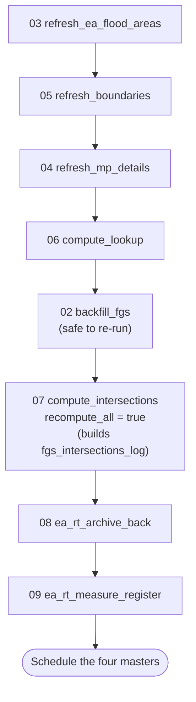
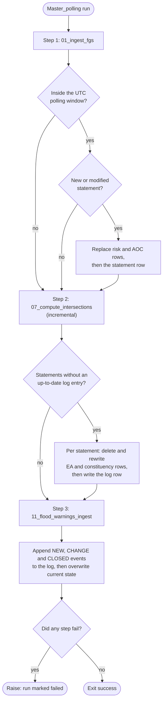
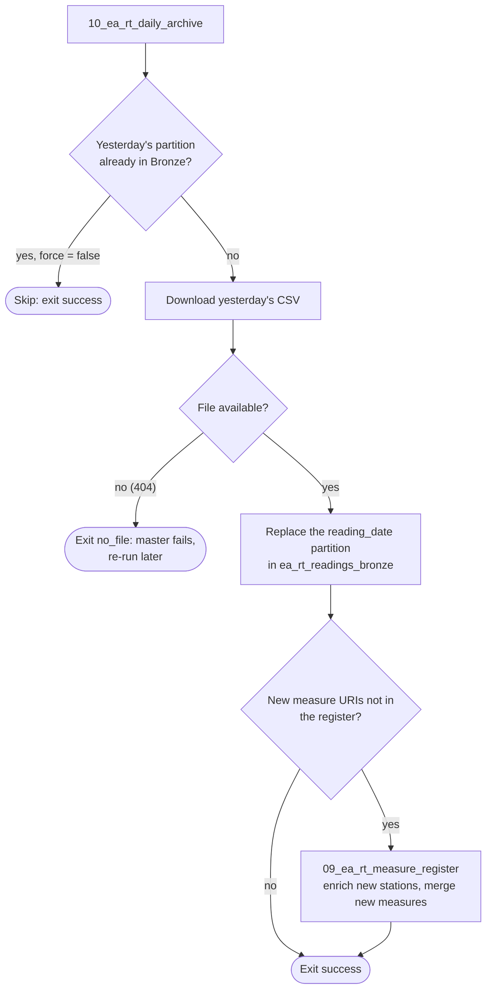
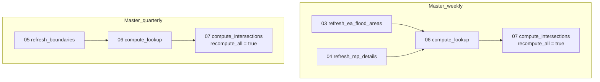
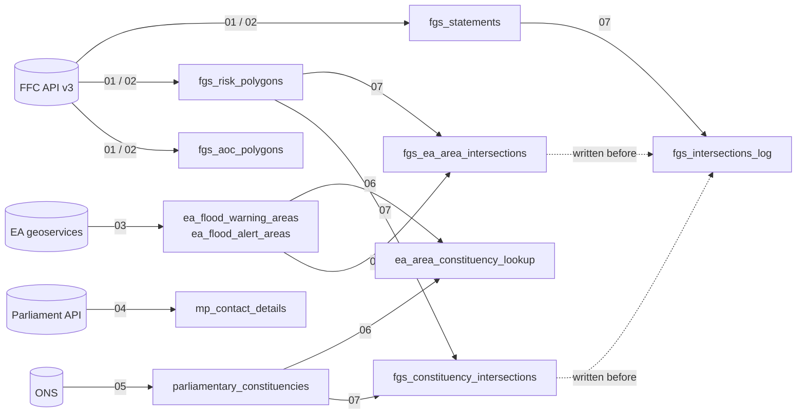

# FGS Pipeline -- DASH / Databricks

Ingests the Flood Guidance Statement from the FFC API v3, stores it as a
queryable Delta Lake history, and maintains a set of spatial intersection
tables linking FGS risk geometries to EA flood areas and parliamentary
constituencies. It also lands EA real-time flood warnings and river readings.

---

## Before you start

### 1. Set up the Databricks secret scope

Run this once from the Databricks CLI on your local machine. You need the
Databricks CLI installed and configured first.

```bash
databricks secrets create-scope fgs-pipeline
databricks secrets put-secret fgs-pipeline ffc-api-key
# Paste your FFC API key when prompted
```

The key is read in `config.py` by `get_ffc_api_key()`. For local development set
the `FFC_API_KEY` environment variable instead. To request a key, email
ffcenquiries@environment-agency.gov.uk (see the FGS Public API documentation).

### 2. Check config.py

- `CATALOG` and `SCHEMA` -- where the tables live (currently
  `prd_dash_lab.flood_forecasting_unrestricted`).
- `SECRET_SCOPE` and `SECRET_KEY` -- only if you used different names above.
- `POLL_START_HOUR` / `POLL_END_HOUR` -- the polling window, in UTC.

Everything else can be left as is unless an external URL changes.

### 3. Deploy to the Databricks workspace

Clone the repo into a Databricks Git folder (or upload it). Notebooks locate the
project root from their own path and call each other by relative path, so the
folder can sit anywhere. Nothing refers to one person's workspace folder.

### 4. First-time run order

1. `jobs/03_refresh_ea_flood_areas`
2. `jobs/05_refresh_boundaries`
3. `jobs/04_refresh_mp_details`
4. `jobs/06_compute_lookup`
5. `jobs/02_backfill_fgs` -- seeds the full statement history. Safe to re-run.
6. `jobs/07_compute_intersections` with widget `recompute_all` = `true`. This
   builds `fgs_intersections_log`. Do this before scheduling the polling master,
   otherwise its first run tries to process the whole history inside a 10 minute
   timeout.
7. For EA real-time data: `jobs/08_ea_rt_archive_back`, then
   `jobs/09_ea_rt_measure_register`.
8. Schedule the masters (see `workflows/scheduling_guide.md`).

### 5. Scheduling

Schedule the four master notebooks with the Databricks notebook scheduler (see
`workflows/scheduling_guide.md`), **or** deploy `workflows/databricks_workflows.yml`
as a bundle (`databricks.yml`) if you have Workflows permissions. Use one or the
other, never both.

---

## Table inventory

| Table | Refresh | Description |
|---|---|---|
| `fgs_statements` | Per FGS issue or modification | One row per statement. Replaced if the statement is modified. |
| `fgs_risk_polygons` | Per FGS issue or modification | One row per geometry per source per day. `geometry_type` is `Polygon` or `LineString` (coastal polylines). |
| `fgs_aoc_polygons` | Per FGS issue or modification | Cartographic AOC geometries. |
| `ea_flood_warning_areas` | Weekly | EA Flood Warning Areas. |
| `ea_flood_alert_areas` | Weekly | EA Flood Alert Areas. |
| `parliamentary_constituencies` | Quarterly | ONS constituency boundaries. |
| `mp_contact_details` | Weekly | Current MPs and contact details. |
| `ea_area_constituency_lookup` | Weekly / quarterly | Static spatial join: EA areas to constituencies (real overlaps only). |
| `fgs_ea_area_intersections` | Per FGS issue | FGS geometries intersecting EA areas. Polygons need 25% coverage of the EA area; lines (coastal) have `intersection_pct` NULL. |
| `fgs_constituency_intersections` | Per FGS issue | FGS geometries intersecting constituencies (any real overlap). |
| `fgs_intersections_log` | Per FGS issue | One row per statement once intersected, with the `last_modified_at` it was computed at. |
| `ea_rt_readings_bronze` | Daily | EA real-time readings, partitioned by `reading_date`. |
| `ea_rt_measure_register` | Daily (new measures) | One row per measure, enriched from the station API. |
| `flood_warnings_current` | Every poll | Live state of EA flood warnings and alerts. |
| `flood_warnings_log` | Every poll | Append-only log of NEW / SEVERITY_CHANGE / MESSAGE_CHANGE / CLOSED events. |
| `ea_administrative_areas` | Manual | EA and Natural England administrative boundaries. |

### Risk matrix labels

`risk_x` is impact and `risk_y` is likelihood, as in the FGS Public API
documentation:

| Value | Impact (`risk_x`) | Likelihood (`risk_y`) |
|---|---|---|
| 1 | Minor | Low (10-25%) |
| 2 | Moderate | Medium (25-50%) |
| 3 | Significant | High (50-75%) |
| 4 | Extreme | Very High (>75%) |

`risk_level` and `risk_colour` come from the FGS User Guide matrix in
`utils/helpers.py` (`RISK_MATRIX`). The API documentation gives positions only,
so check that table against the published guide.

---

## Order of processing

### First-time setup

Run these by hand, once, in this order. Steps 1 to 4 load the reference data the
intersections depend on. Step 6 must finish before the polling master is
scheduled.



### Polling (Master_polling, every 30 or 60 minutes)

Every step runs on every poll. A failure is recorded and the later steps still
run, then the notebook raises at the end so the run is marked as failed.



### Daily (Master_daily, 23:00 UTC)



### Weekly (Sunday 02:00 UTC) and quarterly (or after an election)



In the workflow definition the two weekly refreshes run in parallel. In
`Master_weekly` they run one after the other.

### How the tables are built



The EA real-time tables are separate: `10` lands `ea_rt_readings_bronze`, `09`
builds `ea_rt_measure_register` from it, and `11` writes `flood_warnings_current`
and `flood_warnings_log`.

### How re-runs stay safe

- A statement is identified by `statement_id` and `last_modified_at`. A modified
  statement is ingested again and its old rows are **replaced**, never
  duplicated.
- Child tables are written first and `fgs_statements` last, so a failure part
  way through is retried in full on the next poll.
- `07_compute_intersections` deletes a statement's rows before writing them and
  records the statement in `fgs_intersections_log` last. `recompute_all` is
  therefore safe to run as often as you like.

---

## Typical query: which MPs need to be alerted?

```sql
-- MPs whose constituencies intersect an amber or red river risk today,
-- from the most recent statement.
SELECT DISTINCT
    mp.name               AS mp_name,
    mp.party,
    mp.email,
    mp.constituency_name,
    fi.source,
    fi.risk_colour,
    fi.risk_level,
    fi.forecast_date

FROM prd_dash_lab.flood_forecasting_unrestricted.fgs_constituency_intersections fi
JOIN prd_dash_lab.flood_forecasting_unrestricted.mp_contact_details mp
  ON fi.constituency_name = mp.constituency_name      -- joined on name: the Parliament API gives no ONS code

WHERE fi.statement_id = (
        SELECT MAX(statement_id)
        FROM prd_dash_lab.flood_forecasting_unrestricted.fgs_statements)
  AND fi.forecast_date = CURRENT_DATE()
  AND fi.source        = 'river'
  AND fi.risk_colour IN ('Amber', 'Red')

ORDER BY CASE fi.risk_colour WHEN 'Red' THEN 1 ELSE 2 END, mp.constituency_name;
```

The name join can miss MPs whose constituency is spelled differently in the two
sources. Check for unmatched names after each constituency or MP refresh:

```sql
SELECT c.name
FROM prd_dash_lab.flood_forecasting_unrestricted.parliamentary_constituencies c
LEFT JOIN prd_dash_lab.flood_forecasting_unrestricted.mp_contact_details m
  ON c.name = m.constituency_name
WHERE m.member_id IS NULL;
```

---

## After a general election

Run these two jobs manually, in order, before the next polling window:

1. `05_refresh_boundaries`
2. `04_refresh_mp_details`

Then run `master_quarterly` (or `06_compute_lookup` followed by
`07_compute_intersections` with `recompute_all` = `true`).

---

## Files

```
.
├── config.py                          All settings -- edit this first
├── databricks.yml                     Asset bundle (only if you use Workflows)
├── utils/
│   ├── helpers.py                     Parsing, API access, idempotent writes
│   └── geo.py                         GeoPandas helpers (06 and 07 only)
├── jobs/
│   ├── 01_ingest_fgs                  Live polling and ingest
│   ├── 02_backfill_fgs                Historical backfill (re-runnable)
│   ├── 03_refresh_ea_flood_areas      Weekly EA area refresh
│   ├── 04_refresh_mp_details          Weekly MP contact refresh
│   ├── 05_refresh_boundaries          Quarterly constituency refresh
│   ├── 06_compute_lookup              EA area / constituency spatial join
│   ├── 07_compute_intersections       FGS geometry intersection computation
│   ├── 08_ea_rt_archive_back          One-off EA real-time backfill
│   ├── 09_ea_rt_measure_register      EA measure register
│   ├── 10_ea_rt_daily_archive         Daily EA real-time archive ingest
│   ├── 11_flood_warnings_ingest       EA flood warnings current state + log
│   └── 12_ea_area_boundaries_download EA administrative boundaries (manual)
├── master/                            Schedule these notebooks
│   ├── Master_polling, Master_daily, Master_weekly, Master_quarterly
├── tests/                             pytest suite for the parsing and spatial helpers
└── workflows/
    ├── databricks_workflows.yml       Workflow definitions (optional)
    └── scheduling_guide.md            Notebook scheduler instructions
```

## Tests

```bash
pip install pytest pandas pyspark geopandas shapely requests
pytest tests
```

The tests cover label mapping, geometry-type handling (polygon versus coastal
polyline), row parsing against the explicit schemas, and the coverage and
repair logic. They do not need a Spark session or Databricks.
