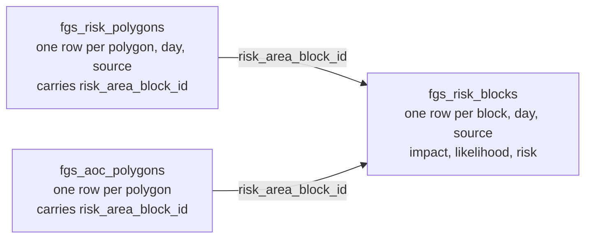
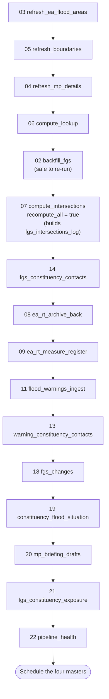
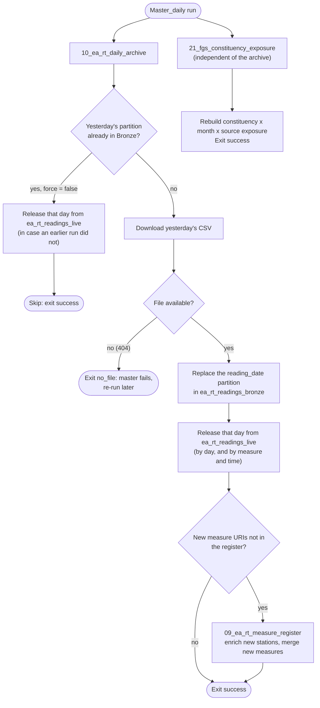
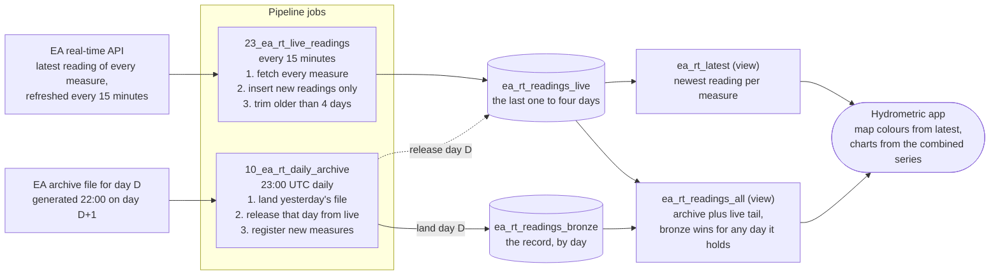
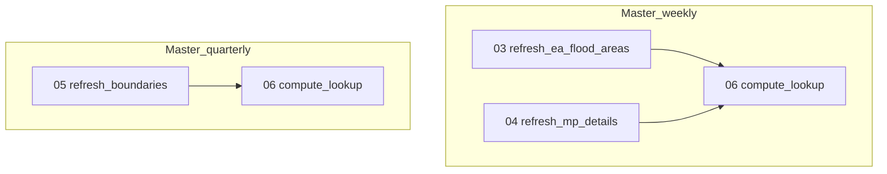
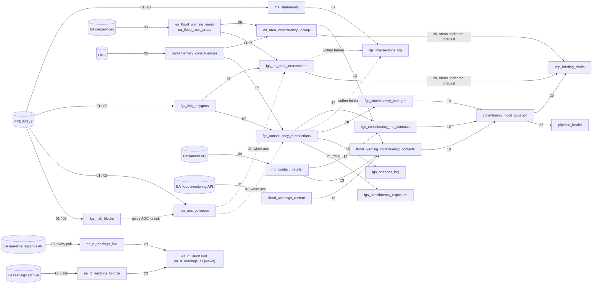

# FGS Pipeline -- DASH / Databricks

Ingests the Flood Guidance Statement from the FFC API v3, stores it as a
queryable Delta Lake history, and maintains a set of spatial intersection
tables linking FGS risk geometries to EA flood areas and parliamentary
constituencies. It also lands EA real-time flood warnings and river readings for
every site: a daily archive, plus a live tail polled every 15 minutes that covers
the one to two days before the archive arrives.

On top of those it builds the products people use: what changed since the previous
statement, one row per constituency (forecast, warnings in force, MP), draft MP
briefings (never sent), monthly exposure history, and a pipeline health table. The
whole polling run happens every 15 minutes.

---

## Before you start

### 0. Python packages (serverless and classic compute)

Notebooks 03, 05, 06, 07 and 12 need `geopandas`. Serverless compute does not
ship it, so each of those notebooks starts with a `%pip install -q geopandas`
cell. Run the notebook from the top (Run all) so that cell executes first. It
restarts Python, which is why it must come before the widgets and imports. On a
classic cluster with geopandas already installed the cell is a quick no-op.

### 1. Provide the FFC API key

`config.get_ffc_api_key()` looks for the key in this order and uses the first it
finds:

1. **A Databricks secret** (preferred, if you can create a scope). Run once from
   the Databricks CLI on your local machine:

   ```bash
   databricks secrets create-scope fgs-pipeline
   databricks secrets put-secret fgs-pipeline ffc-api-key
   # Paste your FFC API key when prompted
   ```

2. **The `FFC_API_KEY` environment variable.**
3. **A `.env` file** containing a line `FFC_API_KEY=your-key`. `.env` is in
   `.gitignore`, so it is never committed. It is looked for in the first of:
   - the path in the `FGS_ENV_FILE` environment variable, if set;
   - next to `config.py`, inside the repo folder;
   - **the folder above the repo folder**, outside the repo.

   Put it in the folder above. A Git pull, branch switch or reset on the repo folder
   can remove files inside it, including ignored ones, and a file in the folder above
   is not part of the repo, so Git never touches it. If the repo is
   `/Workspace/Users/you/fgs_pipeline`, the file goes at `/Workspace/Users/you/.env`.
   `python-dotenv` is not needed.

A `.env` file is plain text, so anyone who can open that folder can read the key. A
secret scope is the safer home for it if your permissions allow. To request a key,
email ffcenquiries@environment-agency.gov.uk (see the FGS Public API documentation).

### 2. Check config.py

- `CATALOG` and `SCHEMA` -- where the tables live (currently
  `prd_dash_lab.flood_forecasting_unrestricted`).
- `SECRET_SCOPE` and `SECRET_KEY` -- only if you used different names for the secret.
- `POLL_START_HOUR` / `POLL_END_HOUR` -- the polling window, in UTC. It applies to
  the FGS ingest only. Flood warnings and live readings run all day.
- `WARNING_CONTACT_MIN_PCT` / `FGS_CONTACT_MIN_PCT` -- the share of an area (or of
  a constituency) that must overlap before a link is written. Also used to count
  the flood warning and alert areas under the forecast.
- `EA_RT_LIVE_*` and `HEALTH_LIVE_WARN_HOURS` -- the live readings job and its
  health check (see "Live readings and the daily archive").

Everything else can be left as is unless an external URL changes.

### 3. Deploy to the Databricks workspace

Clone the repo into a Databricks Git folder (or upload it). Notebooks locate the
project root from their own path and call each other by relative path, so the
folder can sit anywhere. Nothing refers to one person's workspace folder.

### 4. First-time run order

1. `jobs/03_refresh_ea_flood_areas`
2. `jobs/05_refresh_boundaries`
3. `jobs/04_refresh_mp_details`
4. `jobs/06_compute_lookup`
5. `jobs/02_backfill_fgs` -- seeds the full statement history. Safe to re-run.
   Re-run it on an existing install to add `fgs_risk_blocks` and the AOC block ids.
   The history is large (thousands of statements, 50 per page), and a page can
   time out. Each page is saved before the next is fetched, so nothing is lost. If
   it fails, the output says which page to resume from: set the widget
   `start_page` to that number (keep `page_size` the same) and run again.
   `timeout_seconds` (default 120) can be raised for a slow page. Re-running is
   always safe.
6. `jobs/07_compute_intersections` with widget `recompute_all` = `true`. This
   builds `fgs_intersections_log`. Do this before scheduling the polling master,
   otherwise its first run tries to process the whole history inside a 10 minute
   timeout.
7. For EA real-time data: `jobs/08_ea_rt_archive_back`, then
   `jobs/09_ea_rt_measure_register`, then `jobs/23_ea_rt_live_readings` once by
   hand. That creates `ea_rt_readings_live` and the two views over it; the polling
   master then keeps it filled. Check it: the live table should hold several
   thousand distinct measures.
8. `jobs/14_fgs_constituency_contacts`. It needs the intersections (6) and the MP
   table (3).
9. `jobs/11_flood_warnings_ingest`, then `jobs/13_warning_constituency_contacts`.
   Step 13 needs the lookup (4), the MP table (3) and the current warnings (this
   step), so it is last.
10. The products built on those tables, in this order (see "Products built on the
    forecast and warnings" below): `jobs/18_fgs_changes` (needs at least two
    complete statements, otherwise it exits `no_previous`),
    `jobs/19_constituency_flood_situation`, `jobs/20_mp_briefing_drafts`,
    `jobs/21_fgs_constituency_exposure`, `jobs/22_pipeline_health`. On an existing
    install, run 18 once after updating: it adds the headline count columns to
    `fgs_changes_log`, and a restart of the Python session is needed first if
    `config.py` changed (Databricks keeps an imported module until it restarts).
11. Schedule the masters (see `workflows/scheduling_guide.md`). `Master_polling`
    every 15 minutes.

### Starting over on an existing install

If the tables were built by an earlier version of this pipeline, the simplest and
safest route is to rebuild the FGS-derived tables from the API. The FFC backfill
recreates the whole statement history, so nothing is lost.

**Keep** these. They cannot be recreated:

- `flood_warnings_log`. The EA API only returns current state, so deleted events
  are gone for good.
- `ea_rt_readings_bronze`. It grows daily, and the archive only reaches back 30
  days, so dropping it loses anything older.
- `ea_rt_measure_register` is compatible and costs about 15 minutes of API calls to
  rebuild, so there is no reason to drop it.
- `mp_briefing_drafts`. Rows a person has moved on (`reviewed`, `sent`, `rejected`)
  record a human decision and cannot be recreated.

**Drop** the FGS-derived tables, then clear the live warnings state (not the log):

```sql
DROP TABLE IF EXISTS prd_dash_lab.flood_forecasting_unrestricted.fgs_statements;
DROP TABLE IF EXISTS prd_dash_lab.flood_forecasting_unrestricted.fgs_risk_polygons;
DROP TABLE IF EXISTS prd_dash_lab.flood_forecasting_unrestricted.fgs_aoc_polygons;
DROP TABLE IF EXISTS prd_dash_lab.flood_forecasting_unrestricted.fgs_risk_blocks;
DROP TABLE IF EXISTS prd_dash_lab.flood_forecasting_unrestricted.fgs_ea_area_intersections;
DROP TABLE IF EXISTS prd_dash_lab.flood_forecasting_unrestricted.fgs_constituency_intersections;
DROP TABLE IF EXISTS prd_dash_lab.flood_forecasting_unrestricted.fgs_intersections_log;
DROP TABLE IF EXISTS prd_dash_lab.flood_forecasting_unrestricted.fgs_constituency_mp_contacts;
DROP TABLE IF EXISTS prd_dash_lab.flood_forecasting_unrestricted.flood_warning_constituency_contacts;
DROP TABLE IF EXISTS prd_dash_lab.flood_forecasting_unrestricted.ea_area_constituency_lookup;
DROP TABLE IF EXISTS prd_dash_lab.flood_forecasting_unrestricted.fgs_constituency_changes;
DROP TABLE IF EXISTS prd_dash_lab.flood_forecasting_unrestricted.fgs_changes_log;
DROP TABLE IF EXISTS prd_dash_lab.flood_forecasting_unrestricted.constituency_flood_situation;
DROP TABLE IF EXISTS prd_dash_lab.flood_forecasting_unrestricted.fgs_constituency_exposure;
DROP TABLE IF EXISTS prd_dash_lab.flood_forecasting_unrestricted.pipeline_health;

-- Clear the live state so the first run does not log a CLOSED event for every
-- stale warning left over from the old workflow. Do NOT clear flood_warnings_log.
DELETE FROM prd_dash_lab.flood_forecasting_unrestricted.flood_warnings_current;
```

The EA areas, constituencies and MP tables are overwritten in full by their jobs, so
they do not need dropping. `ea_rt_readings_live` and its two views can be dropped and
rebuilt at any time by running `23_ea_rt_live_readings`; it only holds the last few
days. Pause every old schedule first. Then follow the first-time
run order below, skipping `08` and `09` because the bronze and register tables
already exist. Run `Master_polling` once by hand before scheduling the masters.

### 5. Scheduling

Schedule the four master notebooks with the Databricks notebook scheduler (see
`workflows/scheduling_guide.md`), **or** deploy `workflows/databricks_workflows.yml`
as a bundle (`databricks.yml`) if you have Workflows permissions. Use one or the
other, never both.

`Master_polling` runs **every 15 minutes**. The EA flood warnings API and the EA
real-time readings API both refresh every 15 minutes, and every step is idempotent
and exits quickly when nothing is new. Only one run happens at a time, so a run
longer than 15 minutes makes the next one skip: check the run durations in
Databricks, and slacken to 30 minutes if they approach 15.

---

## Table inventory

| Table | Refresh | Description |
|---|---|---|
| `fgs_statements` | Per FGS issue or modification | One row per statement. Replaced if the statement is modified. |
| `fgs_risk_polygons` | Per FGS issue or modification | One row per geometry per source per day. `geometry_type` is `Polygon` or `LineString` (coastal polylines). |
| `fgs_aoc_polygons` | Per FGS issue or modification | Area of Concern geometries, one row per polygon. Each carries `risk_area_block_id`, its link to `fgs_risk_blocks`. |
| `fgs_risk_blocks` | Per FGS issue or modification | One row per risk area block, forecast day and flood source (impact, likelihood, risk). No geometry. The link between `fgs_risk_polygons` and `fgs_aoc_polygons`. |
| `ea_flood_warning_areas` | Weekly | EA Flood Warning Areas. |
| `ea_flood_alert_areas` | Weekly | EA Flood Alert Areas. |
| `parliamentary_constituencies` | Quarterly | ONS constituency boundaries. |
| `mp_contact_details` | Weekly | Current MPs and contact details. |
| `ea_area_constituency_lookup` | Weekly / quarterly | Static spatial join: EA areas to constituencies (real overlaps only). |
| `fgs_ea_area_intersections` | Per FGS issue | FGS geometries (from the source chosen in `FGS_GEOMETRY_SOURCE`, tagged `geometry_source`) intersecting EA areas. Polygons need 25% coverage of the EA area; lines (coastal) have `intersection_pct` NULL. |
| `fgs_constituency_intersections` | Per FGS issue | FGS geometries intersecting constituencies (any real overlap), tagged `geometry_source`. |
| `fgs_intersections_log` | Per FGS issue | One row per statement and `geometry_source` once intersected, with the `last_modified_at` it was computed at. |
| `ea_rt_readings_bronze` | Daily (10, 23:00 UTC) | EA real-time readings, partitioned by `reading_date`. The archive for a day is generated at 22:00 the day after, so this is one to two days behind: see `ea_rt_readings_live`. |
| `ea_rt_measure_register` | Daily (new measures) | One row per measure, enriched from the station API. |
| `ea_rt_readings_live` | Every poll (23) | The live tail of EA real-time readings, every site: the last few days, polled from the EA API every 15 minutes. The daily archive lands one to two days late, so this covers the gap. Job 10 releases each day from it once that day is in bronze. |
| `ea_rt_latest` (view) | Every poll (23) | The newest live reading per measure. A map colours from this. |
| `ea_rt_readings_all` (view) | Every poll (23) | The archive and the live tail as one series. Bronze wins for any day it holds, so there are no duplicates. `source` says which. |
| `flood_warnings_current` | Every poll | Live state of EA flood warnings and alerts. |
| `flood_warnings_log` | Every poll | Append-only log of NEW / SEVERITY_CHANGE / MESSAGE_CHANGE / CLOSED events. |
| `ea_warning_messages_history` | Once (25, with `source_path`) | The EA message history file, cleaned and stored once. A closed record: it does not change. |
| `ea_warning_episodes` | Every poll, at most hourly (25) | Each run of a flood alert, flood warning or severe flood warning in force in an area, with start, end and duration, from the EA message history and `flood_warnings_log`. |
| `ea_warning_periods` | Every poll, at most hourly (25) | Each run at one level inside an episode, so a warning that goes severe has three periods. |
| `fgs_constituency_mp_contacts` | Every poll | The latest complete FGS forecast (proactive): one row per geometry, day, source and constituency, with the sitting MP and contact details. |
| `flood_warning_constituency_contacts` | Every poll | Current warnings and alerts, one row per constituency each overlaps, with the sitting MP and contact details. |
| `fgs_changes_log` | Every poll (18) | One row per statement compared, with the number of differences. A zero means the comparison ran and nothing moved on the days both statements cover; no row means 18 has not compared that statement. It also holds `flagged_*` and `medium_plus_*`: how many constituencies each statement flags over all five of its own days, so "30 at Very Low yesterday, none today" shows even when those days have rolled off. |
| `fgs_constituency_changes` | Every poll (18) | What changed against the previous statement, per constituency, forecast day and flood source. History: rows for each statement are kept. |
| `constituency_flood_situation` | Every poll (19) | One row per constituency: worst forecast risk and when, risk by day, escalation flag, warnings and alerts in force, and the MP. |
| `mp_briefing_drafts` | Every poll (20) | DRAFT briefings for MPs whose constituency is forecast at risk, including how many flood warning and alert areas lie under the forecast. Nothing is sent. `status` starts as `draft`. |
| `fgs_constituency_exposure` | Daily (21) | Days each constituency sat at each risk rank, by calendar month and flood source. Sparse. |
| `ea_warning_fgs_coverage` | Daily (26) | Each alert and warning, and whether and when an FGS polygon covered its issue day: the earliest covering statement at each risk rank, and the worst rank on the issue day and on later days. |
| `pipeline_health` | Every poll (22) | One row per health check (age and completeness of the outputs, including the age of the live readings), plus an overall row. |
| `ea_administrative_areas` | Manual | EA and Natural England administrative boundaries. |
| `ea_rt_stations` | Manual (15) | Every EA real-time station, one row per station, from the stations API. |
| `ea_rt_station_measures` | Manual (15) | One row per measure, keyed by `stationReference`. |
| `ea_rt_telemetry_mapping` | Manual (16) | The telemetry mapping file (TelemetryID, FFFS id, WISKI id, gauge name), each row matched to a measure on station and parameter, with a status and a reason. |
| `ea_rt_measures_mapped` (view) | Manual (16) | The measure register with each measure's gauge name, FFFS id and WISKI id. |
| `ea_rt_wiski_lookup` (view) | Manual (16) | Matched measures that carry a WISKI id. Was a station-only join; now a view over the telemetry mapping. |
| `ea_thresholds_all` | Manual (17) | Flood thresholds from the restricted volume. Lives in the restricted schema, `flood_forecasting_restricted`. |

### Risk matrix labels

`risk_x` is impact and `risk_y` is likelihood, as in the FGS Public API
documentation:

| Value | Impact (`risk_x`) | Likelihood (`risk_y`) |
|---|---|---|
| 1 | Minor | Low (10-25%) |
| 2 | Moderate | Medium (25-50%) |
| 3 | Significant | High (50-75%) |
| 4 | Extreme | Very High (>75%) |

`risk_level` and `risk_colour` come from the FGS User Guide matrix in
`utils/helpers.py` (`RISK_MATRIX`). The API documentation gives positions only,
so check that table against the published guide.

---

## Choosing the FGS geometry source: risk areas or AOC

The FGS carries two sets of shapes. The **risk area polygons** (`fgs_risk_polygons`)
define the spatial extent of each risk. The **Area of Concern (AOC) map polygons**
(`fgs_aoc_polygons`) are the detailed map section of the statement. Both are always
ingested and kept. One setting in `config.py` decides which the intersections and
the FGS contact table are built from:

```python
FGS_GEOMETRY_SOURCE = "risk_areas"   # or "aoc"
```

### How the two link

Per the FFC API v3 documentation, every AOC polygon points at a risk area block
with `risk_area_block_id`, and that block gives the flood source, the forecast days
and the impact and likelihood. The pipeline stores the block definitions in
`fgs_risk_blocks`, so an AOC polygon takes its risk from its block:



```sql
-- Each AOC polygon with the risk it inherits from its block
SELECT a.statement_id, a.poly_id AS aoc_poly_id, a.risk_area_block_id,
       b.day_index, b.forecast_date, b.source, b.risk_level, b.risk_colour
FROM prd_dash_lab.flood_forecasting_unrestricted.fgs_aoc_polygons a
JOIN prd_dash_lab.flood_forecasting_unrestricted.fgs_risk_blocks b
  ON  b.statement_id       = a.statement_id
  AND b.risk_area_block_id = a.risk_area_block_id;
```

An AOC polygon appears once per day and source of its block, the same way a risk
polygon does. This link comes from the API documentation, not from live data, so
check it (below) before relying on `"aoc"`.

### What each setting does

| | `"risk_areas"` (default) | `"aoc"` |
|---|---|---|
| Shapes intersected | `fgs_risk_polygons` | `fgs_aoc_polygons` |
| Flood source, day, risk from | the polygon row itself | its block in `fgs_risk_blocks` |
| `poly_id` in the output | the risk polygon id | the AOC polygon id |
| `geometry_source` in the output | `risk_areas` | `aoc` |

Intersection rows are tagged with `geometry_source` and the log is kept per source,
so the two sets **sit side by side in the same tables**. Recomputing one source
replaces only that source's rows and never deletes the other. Rows written before
the tag existed count as `risk_areas`. `fgs_constituency_mp_contacts` (job 14)
follows the same setting.

### Switching, and bringing existing data up to date

1. **Once, now:** re-run `jobs/02_backfill_fgs`. It is safe to re-run. It writes
   `fgs_risk_blocks` and adds `risk_area_block_id` to the existing AOC rows, which
   were stored without it.
2. Set `FGS_GEOMETRY_SOURCE` in `config.py`.
3. Run `jobs/07_compute_intersections` with widget `recompute_all` = `true`. Do this
   by hand; it covers the whole history for the chosen source. Then run
   `jobs/14_fgs_constituency_contacts`.
4. The polling master carries on with the chosen source.

### Check the link before choosing AOC

```sql
-- 1. Do AOC polygons carry a block id, and do those blocks exist?
SELECT COUNT(*)                                             AS aoc_polygons,
       COUNT(a.risk_area_block_id)                          AS with_block_id,
       COUNT(DISTINCT CASE WHEN b.risk_area_block_id IS NOT NULL
                           THEN a.statement_id || '-' || a.poly_id END) AS linked_to_a_block
FROM prd_dash_lab.flood_forecasting_unrestricted.fgs_aoc_polygons a
LEFT JOIN (SELECT DISTINCT statement_id, risk_area_block_id
           FROM prd_dash_lab.flood_forecasting_unrestricted.fgs_risk_blocks) b
  ON b.statement_id = a.statement_id AND b.risk_area_block_id = a.risk_area_block_id;

-- 2. Which source is each intersection table holding?
SELECT COALESCE(geometry_source, 'risk_areas') AS geometry_source, COUNT(*)
FROM prd_dash_lab.flood_forecasting_unrestricted.fgs_constituency_intersections
GROUP BY 1;
```

If `with_block_id` is zero after the re-run, the API does not return
`risk_area_block_id` on AOC polygons. AOC shapes then cannot be given a risk, and
job 07 fails with a message saying so. Stay on `"risk_areas"` and tell me what the
API does return.

## Order of processing

### First-time setup

Run these by hand, once, in this order. Steps 1 to 4 load the reference data the
intersections depend on. Step 6 must finish before the polling master is
scheduled.



### Polling (Master_polling, every 15 minutes)

Every step runs on every poll. A failure is recorded and the later steps still
run, then the notebook raises at the end so the run is marked as failed. The
exit values (`outside_window`, `no_change`, `no_work`) are normal outcomes, not
failures. The one exception to "a failure is raised at the end" is step 0, the live
readings: a failure there is printed and shown in the summary but does not fail the
run, so a bad spell at the EA cannot fire the alert that protects the FGS and
warnings. The `ea_live_readings_age` health check in step 9 warns, and never fails,
if the newest live reading is over an hour old.

```mermaid
flowchart TD
    start(["Master_polling run"]) --> S0["Step 0: 23_ea_rt_live_readings<br/>(first, 3 minute timeout)"]
    S0 --> W0["Latest reading of every measure into ea_rt_readings_live<br/>Exit success, or skipped_recent if filled under 10 minutes ago"]
    W0 --> S1["Step 1: 01_ingest_fgs"]
    S1 --> D0{"Inside the UTC<br/>polling window?"}
    D0 -- no --> X0["Exit outside_window"]
    D0 -- yes --> D1{"New or modified<br/>statement?"}
    D1 -- no --> X1["Exit no_change"]
    D1 -- yes --> W1["Replace risk and AOC rows,<br/>then the statement row<br/>Exit success"]
    X0 --> S2
    X1 --> S2
    W1 --> S2["Step 2: 07_compute_intersections<br/>(incremental)"]
    S2 --> D2{"Statements without an<br/>up-to-date log entry?"}
    D2 -- no --> X2["Exit no_work<br/>(nothing to compute)"]
    D2 -- yes --> W2["Per statement: delete and rewrite<br/>EA and constituency rows,<br/>then write the log row<br/>Exit success"]
    X2 --> S3
    W2 --> S3["Step 3: 14_fgs_constituency_contacts<br/>(proactive)"]
    S3 --> W3["Rebuild the latest complete forecast<br/>x constituencies x MP contacts<br/>Exit success"]
    W3 --> S4["Step 4: 11_flood_warnings_ingest<br/>(no window check)"]
    S4 --> W4["Append NEW, CHANGE and CLOSED events<br/>to the log, then overwrite current state<br/>Exit success or no_change"]
    W4 --> S5["Step 5: 13_warning_constituency_contacts<br/>(reactive, no window check)"]
    S5 --> W5["Rebuild warnings x constituencies x MP contacts<br/>Exit success"]
    W5 --> S6["Step 6: 18_fgs_changes"]
    S6 --> W6["Compare the latest complete statement with the previous one<br/>Exit success or no_previous"]
    W6 --> S7["Step 7: 19_constituency_flood_situation"]
    S7 --> W7["One row per constituency: forecast, warnings, MP<br/>Exit success"]
    W7 --> S8["Step 8: 20_mp_briefing_drafts"]
    S8 --> W8["Drafts only, never sent. Refuses if step 7 is out of date<br/>Exit success"]
    W8 --> S9["Step 9: 22_pipeline_health"]
    S9 --> W9["Write one row per check. Raises if a check fails<br/>Exit success"]
    W9 --> D3{"Did any step fail?"}
    D3 -- yes --> F(["Raise: run marked failed"])
    D3 -- no --> OK(["Exit success"])
```



### Daily (Master_daily, 23:00 UTC)



### Live readings and the daily archive

The daily archive is generated at 22:00 on the day after, and Master_daily lands it
at 23:00, so `ea_rt_readings_bronze` is one to two days behind. `23_ea_rt_live_readings`
fills that gap: it fetches the latest reading of every measure (every site) from the EA
API and keeps the last few days in `ea_rt_readings_live`. When a day's archive reaches
bronze, `10_ea_rt_daily_archive` releases that day from the live table. The archive is
the record and includes late telemetry; the live table is only the gap.



Where each day lives, with Monday as the day in question:

| When | Saturday | Sunday | Monday | Tuesday |
|---|---|---|---|---|
| Tuesday 10:00 | bronze | bronze | live | live (so far) |
| Tuesday after 23:00 | bronze | bronze | bronze (released from live) | live (so far) |

`ea_rt_readings_all` never shows a reading twice. A live row is dropped for any day
bronze holds, and also when bronze holds the same measure and reading time, because
bronze files a row under the archive file's date, which can differ from the reading's
own date at a day boundary. `source` says which table a row came from. Join to
`ea_rt_measure_register` or `ea_rt_stations` on `measure_uri` for station details.

Schedule: step 0 of `Master_polling`, so every 15 minutes, which is the rate the EA API
refreshes. It is not fatal to the run (see "Polling"). If you also want it on its own
schedule, schedule `jobs/23_ea_rt_live_readings` directly: it skips itself if the table
was filled in the last 10 minutes, so it cannot double-call the API. Show the Open
Government Licence attribution wherever the readings are displayed.

A quick check after the first run, and after the first 23:00 archive:

```sql
-- every site is in: several thousand measures
SELECT COUNT(*) AS readings, COUNT(DISTINCT measure_uri) AS measures
FROM prd_dash_lab.flood_forecasting_unrestricted.ea_rt_readings_live;

-- no reading appears twice in the combined series
SELECT measure_uri, date_time, COUNT(*) AS n
FROM prd_dash_lab.flood_forecasting_unrestricted.ea_rt_readings_all
WHERE reading_date >= current_date() - 3
GROUP BY measure_uri, date_time HAVING COUNT(*) > 1 LIMIT 20;
```

### Weekly (Sunday 02:00 UTC) and quarterly (or after an election)



In the workflow definition the two weekly refreshes run in parallel. In
`Master_weekly` they run one after the other.

### History is an archive: nothing recomputes it

The weekly and quarterly runs do **not** recompute historical intersections. This
is deliberate.

- The statement polygons (`fgs_risk_polygons`, `fgs_aoc_polygons`) are the record
  of what the FFC said. They never change.
- The intersection tables are derived from them. Each statement keeps the
  intersections computed when it was issued, against the EA areas and
  constituencies of that time. That is what the business was recommending, to
  whom, at the time.
- Recomputing every week would rewrite the past against today's boundaries. After
  a general election it would restate every old forecast in the new
  constituencies, so the record would no longer match who held which seat then.
  It also takes longer than any sensible job timeout.

Two consequences to know about:

- The history backfilled when the pipeline was first set up was intersected
  against the boundaries in force that day, because it could not have been done
  earlier. It is the best available, not truly as-at-the-time for old statements.
  From then on each new statement is intersected when issued.
- After a boundary change, `constituency_id` values that exist only afterwards
  have no history before the change, so `fgs_constituency_exposure` for them
  starts at the change.

A full recompute is a manual, deliberate act: run `07_compute_intersections` with
`recompute_all` = `true`. Do it only after fixing a bug in `07` or its geometry
logic, never as routine. It overwrites the archive.

### How the tables are built



There are two contact tables, one for each way of looking at flood risk.
`fgs_constituency_mp_contacts` is proactive: it starts from the forecast (the
FGS), so an MP can be told before any warning exists.
`flood_warning_constituency_contacts` is reactive: it starts from warnings the EA
has already issued (`11`), through the spatial lookup (`06`). Both end at the
sitting MP (`04`). The
other EA real-time tables are separate: `10` lands `ea_rt_readings_bronze`, `09`
builds `ea_rt_measure_register` from it, `23` keeps `ea_rt_readings_live` (the live
tail over the one to two days before the archive arrives) and the two views that read
through it, and `11` also appends to `flood_warnings_log`.

The products sit on top: `18` compares the latest two statements into
`fgs_constituency_changes` and `fgs_changes_log`, `19` folds the forecast, warnings
and changes into one row per constituency, `20` drafts MP briefings from that and
from the areas under the forecast, `21` counts exposure by month, and `22` checks the
age and completeness of it all.

### How re-runs stay safe

- A statement is identified by `statement_id` and `last_modified_at`. A modified
  statement is ingested again and its old rows are **replaced**, never
  duplicated.
- Child tables are written first and `fgs_statements` last, so a failure part
  way through is retried in full on the next poll.
- `14_fgs_constituency_contacts` and `13_warning_constituency_contacts` rebuild
  their tables in full on every poll, so each always matches the current forecast
  or the current warnings. History is in the FGS tables and `flood_warnings_log`.
- `07_compute_intersections` deletes a statement's rows before writing them and
  records the statement in `fgs_intersections_log` last. `recompute_all` is
  therefore safe to run as often as you like.
- `18_fgs_changes` replaces its rows and its `fgs_changes_log` row for the statement,
  so a re-run never duplicates. `20_mp_briefing_drafts` replaces drafts still marked
  `draft` and never touches one a person has moved on.
- `23_ea_rt_live_readings` inserts only readings not already held (a match on measure
  and reading time), so the same call twice, or two schedules overlapping, never
  duplicates. `10_ea_rt_daily_archive` releases each archived day from the live table,
  by day and by measure and time, and does so again if the day was already in bronze.
  `ea_rt_readings_all` never shows a reading twice: bronze wins for any day it holds.

---

## The forecast (FGS), by constituency and MP: proactive

`fgs_constituency_mp_contacts` holds the latest statement whose intersections are
complete. It is the forecast for the next five days, so it shows where flooding is
possible before any warning is issued. The grain is one row per FGS geometry,
forecast day, flood source and constituency, so a constituency usually has several
rows a day. Rank them to get the worst risk.

```sql
-- MPs whose constituency has an Amber or Red risk in the forecast, worst risk per
-- constituency, day and source.
WITH ranked AS (
    SELECT *,
           ROW_NUMBER() OVER (
               PARTITION BY constituency_id, forecast_date, source
               ORDER BY risk_rank DESC, risk_x DESC, risk_y DESC
           ) AS rn
    FROM prd_dash_lab.flood_forecasting_unrestricted.fgs_constituency_mp_contacts
)
SELECT
    forecast_date, constituency_name, source,
    risk_level, risk_colour, impact_label, likelihood_label,
    mp_name, mp_party, mp_email, mp_phone
FROM ranked
WHERE rn = 1
  AND risk_rank >= 3                    -- 3 Medium (Amber), 4 High (Red)
  AND mp_matched
ORDER BY forecast_date, risk_rank DESC, constituency_name;
```

Notes on the table:

- `risk_rank` is 1 Very Low, 2 Low, 3 Medium, 4 High, taken from `risk_level`.
- `geometry_source` says which set of FGS shapes the rows came from (`risk_areas` or
  `aoc`), as set by `FGS_GEOMETRY_SOURCE` in `config.py`. `poly_id` is an id in that
  set.
- It shows the latest statement that is fully intersected. If a newer statement
  has arrived but `07` has not finished it, the table keeps the previous complete
  one and the job output says so. `statement_id` and `issued_at` are on every row.
- `share_of_constituency_covered` is the share of the constituency the FGS
  geometry covers. Links below 1% are not written (`FGS_CONTACT_MIN_PCT` in
  `config.py`). Coastal polylines have no area, so this is NULL and they are
  always kept.
- **Coastal lines are widened before they are matched to constituencies and to EA flood
  areas.** A coastal FGS geometry is a line along the coast. A constituency stops at the
  coast and a coastal flood warning or alert area is a polygon beside it, so a line on or
  just off that edge often crosses neither, and misses areas it should reach. `07` widens
  each line by `COASTAL_LINE_BUFFER_M` (default 1000 m, each side) for both tests. Those
  rows keep `geometry_type = 'LineString'` and a NULL share (the EA coverage threshold
  applies to polygons only), and the original line is still what the map draws. Polygons
  are never widened. The EA areas matched are the ones whose type codes belong to the
  flood source (coastal: FWC, WAC, FWB, WAB, FWT, WAT).
- **Coastal warning areas are raised through their parent alert area.** Each flood warning
  area names its parent flood alert area (the EA layer's `parent` field). When a coastal
  alert area is under the forecast, `07` also writes a row for each coastal warning area
  whose parent it is, even where the widened line does not reach that warning area.
  `fgs_ea_area_intersections.link_type` says which: `intersects` (the geometry reached
  it, and NULL on rows written before the column existed) or `parent_alert` (raised
  through its parent), and a parent_alert row has a NULL `intersection_pct`. The job prints how many it
  added, and how many coastal warning areas have a parent that is not a known area code,
  which would mean the parent field does not hold the codes the link matches on. Only the
  coastal source is linked, and `COASTAL_LINK_WARNINGS_TO_ALERTS = False` turns it off. To
  see the effect: `SELECT link_type, COUNT(*) FROM
  prd_dash_lab.flood_forecasting_unrestricted.fgs_ea_area_intersections WHERE
  source = 'coastal' GROUP BY link_type`.
  Set it to 0 to turn this off. After changing it, run `07_compute_intersections` with
  `coastal_only = true`. That recomputes only the statements that hold a coastal line
  (plus anything not yet intersected), which is a small share of history, because no other
  statement can change. `recompute_all = true` still recomputes everything and takes much
  longer. Then run `14`, `18`, `19`, `20` and `21` again so everything built on the
  intersections catches up. A normal run needs neither: new statements use the buffer
  automatically.
- `mp_matched = false` marks a constituency with no matching MP. The job lists
  them, and fails if no constituency matches any MP.
- Like the reactive table, it is the current picture, not history: MP details are
  overwritten weekly, so old forecasts are not re-stamped with today's MP.

## Flood warnings and alerts, by constituency and MP: reactive

`flood_warning_constituency_contacts` holds the current picture. One warning that
spans three constituencies is three rows. Every row carries the warning, the
constituency and the MP.

```sql
-- MPs with a Flood Warning or Severe Flood Warning in force in their constituency.
SELECT
    mp_name, mp_party, mp_email, mp_phone,
    constituency_name,
    flood_area_id, flood_area_name, description,
    severity_level, severity_label,
    ROUND(share_of_area_in_constituency, 2) AS share_of_area_in_constituency,
    time_severity_changed
FROM prd_dash_lab.flood_forecasting_unrestricted.flood_warning_constituency_contacts
WHERE is_in_force
  AND severity_level IN (1, 2)          -- 1 Severe Flood Warning, 2 Flood Warning
  AND mp_matched
ORDER BY severity_level, constituency_name;
```

Notes on the table:

- `is_in_force` is false for severity 4 ("Warning no Longer in Force"). Those rows
  stay so a closing warning is still visible. Severity 3 is a Flood Alert.
- `ea_area_type` says whether the area is a `flood_warning` or `flood_alert` area.
- `share_of_area_in_constituency` is the share of the warning area that lies in
  that constituency. Links below 1% are not written, so an MP is not linked to a
  warning that only clips the edge of their constituency. Change
  `WARNING_CONTACT_MIN_PCT` in `config.py` (0.0 keeps every real overlap), or
  filter on this column at query time.
- `mp_matched = false` marks a constituency with no matching MP: a vacancy, or a
  name that differs between the ONS and Parliament sources. The MP is matched on
  a normalised name (lower case, accents folded, `&` as `and`). Each run lists the
  unmatched constituencies in the job output.
- A warning that does not appear at all is not in `ea_area_constituency_lookup`.
  The job lists these. If none match, the job fails, because that means the EA
  warning codes and the area codes no longer agree.

## Products built on the forecast and warnings

Five notebooks turn the intersection and contact tables into things you can use
directly. None does spatial work: all are plain Spark SQL over tables that already
exist, so they are cheap. `18`, `19`, `20` and `22` run on every poll (steps 6 to 9
of `Master_polling`). `21` runs daily (step 2 of `Master_daily`).

Ranks used throughout: 1 Very Low, 2 Low, 3 Medium, 4 High, 0 nothing flagged.

### What changed: `fgs_constituency_changes` (18)

Compares the latest complete statement with the one before it, per constituency,
forecast day and flood source. Only days both statements cover are compared, so a
day rolling off the old statement or a day newly added is never reported as a
change. Unchanged cells are not stored. `change_type` is `new`, `escalated`,
`de_escalated` or `cleared`. Rows for each statement are kept, so the table is a
history of changes.

Because unchanged cells are not stored, an empty result alone cannot tell "nothing
moved" from "18 has not run for this statement". So 18 also writes one row per
compared statement to `fgs_changes_log`, with `n_changes` (zero is a real "nothing
moved"), the days compared, and a status (`compared` or `no_shared_days`).

The day-by-day rows leave out days the newer statement no longer covers, on purpose:
a risk on a day that has rolled off is not a change in the forecast. But a forecast
that goes from 30 constituencies at Very Low to none is a real change in the
statement, so the log row also holds the headline counts: `flagged_previous` and
`flagged_new` (constituencies with any risk over all five of each statement's own
days) and `medium_plus_previous` and `medium_plus_new` (at Medium or above).

```sql
SELECT statement_id, previous_statement_id, n_changes, status,
       flagged_previous, flagged_new, medium_plus_previous, medium_plus_new
FROM prd_dash_lab.flood_forecasting_unrestricted.fgs_changes_log
ORDER BY statement_id DESC LIMIT 5;
```

```sql
-- escalations in the latest statement, worst first
SELECT constituency_name, forecast_date, source, previous_rank, new_rank
FROM prd_dash_lab.flood_forecasting_unrestricted.fgs_constituency_changes
WHERE statement_id = (SELECT MAX(statement_id)
                      FROM prd_dash_lab.flood_forecasting_unrestricted.fgs_constituency_changes)
  AND change_type IN ('escalated', 'new')
ORDER BY new_rank DESC, constituency_name;
```

### One row per constituency: `constituency_flood_situation` (19)

Every constituency, with the worst forecast risk over five days (`fgs_worst_rank`,
`fgs_worst_level`, `fgs_worst_date`, `fgs_worst_sources`), the risk on each day
(`fgs_rank_day1` to `fgs_rank_day5`), `fgs_escalated`, counts of severe warnings,
warnings and alerts in force, and the MP. The forecast and the warnings stay in
separate columns on purpose: one says what may happen, the other what the EA
expects. There is no combined score. Observed gauge levels are not included yet.

```sql
SELECT constituency_name, mp_name, fgs_worst_level, fgs_worst_date, fgs_escalated,
       severe_warnings, warnings, alerts
FROM prd_dash_lab.flood_forecasting_unrestricted.constituency_flood_situation
WHERE fgs_worst_rank >= 3 OR has_active_warning
ORDER BY fgs_worst_rank DESC, severe_warnings DESC, warnings DESC;
```

### MP briefing drafts: `mp_briefing_drafts` (20)

A subject and plain-text body per MP whose constituency reaches
`BRIEFING_MIN_RISK_RANK` (default 1, Very Low: any FGS polygon over the constituency)
on any of the five days. Set it to 3 to draft only for Medium and above. At 1 a single
statement can draft for hundreds of constituencies, so a person reviewing them will want
to sort by `worst_rank`.
**Nothing is sent.** The wording is factual (what the statement says, which days,
which sources, whether it has risen), gives no advice, and leaves the sender and
sign-off as a placeholder. A person reviews each draft and sends it by their own
route, then sets `status` (for example `reviewed`, `sent`, `rejected`) and
`reviewed_by`. Re-running for the same statement replaces drafts still marked
`draft` and never touches a row that has moved on. Vacant seats get no draft.

A draft also says how many flood warning areas and flood alert areas sit under the
forecast, for example "10 flood warning areas and 3 flood alert areas lie under the
forecast Medium river flood risk". These are potential warnings and alerts (places
where one could be issued), not ones in force, which the draft states separately.
Only areas under polygons at the constituency's worst risk, for the flood sources
behind it, are counted. An area counts when at least `WARNING_CONTACT_MIN_PCT` of it
lies inside the constituency. If there are none, the sentence is left out.

```sql
SELECT mp_name, mp_email, constituency_name, worst_level, is_escalation, subject, body
FROM prd_dash_lab.flood_forecasting_unrestricted.mp_briefing_drafts
WHERE statement_id = (SELECT MAX(statement_id)
                      FROM prd_dash_lab.flood_forecasting_unrestricted.mp_briefing_drafts)
  AND status = 'draft'
ORDER BY worst_rank DESC;
```

#### Reviewing earlier statements: `24_backfill_mp_briefing_drafts`

Notebook 20 drafts for the latest statement only. To go back over earlier ones, run
`jobs/24_backfill_mp_briefing_drafts` by hand. It rebuilds each statement's picture
from `fgs_constituency_intersections`, which keeps every statement, and writes drafts
in the same wording to the same table with `status = 'draft'`. The `statements`
widget takes `30` (the last 30 complete statements before the latest, the default),
`all`, or exact ids such as `4811,4812`.

It is safe to re-run. A constituency that already has a row for a statement, in any
status, is skipped, so a draft that has been edited or moved on is never touched. The
latest statement is left to notebook 20.

A backfilled draft differs from one made at the time in four ways:

- **Warnings and alerts in force** are not kept historically, so that sentence is left
  out. The sentence about flood warning and alert areas under the forecast stays, because
  `fgs_ea_area_intersections` is kept per statement.
- **The MP** is today's sitting MP for the constituency.
- **"Higher than in the previous statement"** comes from notebook 18. A statement it
  never compared leaves the sentence out, and `is_escalation` is null rather than false.
- **`created_at`** is when the backfill ran. Use `statement_id`, or the issue date in
  the body, to tell which statement a draft is for.

Notebooks 20 and 24 stop with a restart instruction if their Python session holds an
old `BRIEFING_MIN_RISK_RANK`. Databricks keeps an imported `config.py` until the session
restarts, so after a Git pull a notebook that was already open would otherwise draft
against the old threshold. Run `dbutils.library.restartPython()` and run from the top.

To review them, filter on `statement_id` and `status = 'draft'`. The wording is built
by `utils/briefing.py`, shared with notebook 20 and covered by `tests/test_briefing.py`.

### Exposure history: `fgs_constituency_exposure` (21)

Days each constituency sat at each risk rank, by calendar month and flood source
(`source = 'any'` is the worst across sources). Statements overlap, so to count
each date once it uses **day 1 of the last statement issued on each date**. Days 2
to 5 are not counted. The table is sparse: a month with no flagged day has no row,
and `days_covered` (days in that month with a statement) is the denominator. A
gap in the statement history is not counted as a quiet day.

```sql
-- the 20 constituencies with most Medium-or-above days in the last 12 months
SELECT constituency_name, SUM(days_medium_or_above) AS days_medium_or_above
FROM prd_dash_lab.flood_forecasting_unrestricted.fgs_constituency_exposure
WHERE source = 'any' AND month >= date_format(add_months(current_date(), -12), 'yyyy-MM')
GROUP BY constituency_name
ORDER BY days_medium_or_above DESC
LIMIT 20;
```

### Pipeline health: `pipeline_health` (22)

One row per check, with `status` of `ok`, `info`, `warn` or `fail`, and an
`overall` row. The checks measure the age and completeness of what the pipeline
produces, so a pipeline that has stopped running shows up as well as one that is
failing: newest statement, statements awaiting intersections, age of
`constituency_flood_situation`, age of the warnings ingest, age of the newest live
EA reading, unlinked warnings, MP and constituency counts, unmatched MPs. Limits are
`HEALTH_*` in `config.py`. The notebook raises if any check is `fail`, so a scheduled
run is marked failed and your alerts fire. The live readings check
(`ea_live_readings_age`, `HEALTH_LIVE_WARN_HOURS`) warns and never fails: a stale feed
is usually a bad spell at the EA, and it must not fail the run that carries the FGS
and warnings alerts.

### Dashboard

`dashboards/fgs_flood_situation.lvdash.json` is a Databricks AI/BI (Lakeview)
dashboard: three headline counters (constituencies at Medium or above, escalated
since the previous statement, with a warning or alert in force), the constituencies
to watch, the latest escalations, a bar chart of the most exposed constituencies
over 12 months, and the pipeline health checks.

To use it, upload the file to your workspace (Workspace, then Import) and open it,
then pick a SQL warehouse. The table names in its queries are the ones in
`config.py` (`CATALOG`, `SCHEMA`) as they stand today. If you change those, edit
the five dataset queries in the file.

**Untested on Databricks.** The five queries were run against a local Spark and
return the columns the widgets use. The widget layout is written to the Lakeview
file format from memory and has not been imported into a workspace. If the import
fails or a widget looks wrong, the datasets are the valuable part: each is a
plain query you can paste into a new dashboard. A map is not included. To add one,
join `constituency_flood_situation` to `parliamentary_constituencies` on
`constituency_id` and use the `geometry` column.

## Warning and alert history: how long was each in force?

`jobs/25_warning_history_periods` builds the history of every flood alert, flood warning and
severe flood warning, with start, end and duration, from two sources: a file of every message
the EA has issued (a parquet file in a Databricks volume, one row per message with the area
code `TACode`, the time `dateTime` and the severity text), and `flood_warnings_log` (job 11),
which carries on from when polling began. It writes two tables.

The rules are how the EA issues messages, replayed for each area in time order:

| Message | Effect |
|---|---|
| Flood alert | Switches an alert on. |
| Flood warning | Switches a warning on, or turns a severe flood warning down one level. |
| Severe flood warning | Raises an existing warning to severe. |
| Warning no longer in force | Switches the area off, from any level. |

A message at the level an area is already at is an update and changes nothing.

- **`ea_warning_episodes`** has one row per run in force at any level, from the message that
  switched it on to the "no longer in force" that ended it. A warning that goes severe and
  comes back down is one episode, whose `duration_hours` is the whole time in force.
  `peak_level`, `had_severe`, `severe_minutes` and `n_severe_periods` say how much of it was
  severe. `area_type` (flood alert or flood warning) comes from the area code.
- **`ea_warning_periods`** has one row per run at one level inside an episode, linked by
  `episode_id`. A warning that goes severe and back has a flood warning period, a severe
  flood warning period and a flood warning period again. `started_by` and `ended_by` say
  whether each change was an upgrade or a downgrade.
- **The log is joined to the file.** A log row becomes a message in the same form: a NEW or
  SEVERITY_CHANGE is a message at its level at the EA's own `time_severity_changed` (level 1
  severe, 2 warning, 3 alert, 4 no longer in force), a MESSAGE_CHANGE is an update, and a
  CLOSED row whose last level was 4 adds nothing. A CLOSED row whose last level was 1 to 3
  means the area left the feed without a level 4 being seen, so it is a switch off at the
  poll that noticed (`ended_by = dropped_from_feed`, up to one poll late). A message in both
  sources is kept once. `start_origin` and `end_origin` say which source each start and end
  came from. `include_log = false` uses the file alone.
- **The gap.** The file ends before the log's first poll. An area on when the file ends stays
  on until the log says otherwise, and a warning that started and ended inside that stretch
  is in neither source. Episodes that cross it have `spans_gap = true`: treat their duration
  with care. The notebook prints the gap.
- **Open episodes.** Anything with no "no longer in force" by the end of the file has
  `is_open = true` and no `end_time`, and its duration is measured to the latest message in
  the file (`data_as_of`). `stale_open` marks those open for over 30 days, which probably
  lost their end message.
- **Times** are used as written (`dateTime`, which carries a "Z"). If the source recorded UK
  clock time and labelled it Z, a duration that spans a clock change is out by an hour.
- **Checks.** The notebook prints the messages it could not use (no code, no time, an
  unrecognised severity, exact repeats), any rows where the text and the numeric `severity`
  disagree, "no longer in force" messages with nothing on, the log rows it could not use, how
  many messages are in both sources, the median and longest duration by area type, and where
  episodes began and ended. Read these before trusting the tables.

**Loading and scheduling.** The history file is a closed record and does not change, so it is
loaded once. Run the notebook by hand the first time with the `source_path` widget set to the
parquet file or folder: it checks the file and stores the clean messages in
`ea_warning_messages_history`. After that, leave `source_path` blank. New data reaches the
tables only through `flood_warnings_log`, which step 4 of `Master_polling` updates every 15
minutes, so `Master_polling` runs this notebook as its last step (step 10) with
`skip_if_fresh_minutes = 60`. It skips itself when the tables were built less than an hour
ago and the log has no poll newer than that build. The log only gains rows when something
changes, so quiet polls cost one small query, and the age limit still rebuilds hourly so the
duration of anything still in force keeps growing. Open durations are measured to the latest
poll, not just the latest message.

Step 10 is non-fatal: a failure is printed and shown in the run summary but does not fail the
polling run that carries the FGS and warnings alerts, so read the summary if the tables stop
updating. Its run time counts toward the 15 minute cycle, so the notebook prints how long it
took: check that, and raise the skip window or move it to `Master_daily` if it grows. A
rebuild overwrites both tables in full, so a re-run gives the same answer. To reload the file
(a corrected version, say), run it by hand with `source_path` set again.

```sql
-- Longest warnings, and how much of each was severe.
SELECT ea_area_code, start_time, end_time, duration_hours, had_severe, ROUND(severe_minutes / 60, 1) AS severe_hours
FROM prd_dash_lab.flood_forecasting_unrestricted.ea_warning_episodes
WHERE area_type = 'flood_warning' AND NOT is_open
ORDER BY duration_hours DESC LIMIT 20;
```

## Warning coverage: were the warnings under an FGS polygon?

`jobs/26_warning_fgs_coverage` takes each flood alert and warning (an episode from `25`) and
records whether the FGS covered it when it was issued, and when that forecast was made. It writes `ea_warning_fgs_coverage`, one row per
episode. The Flood Planning App's Warnings vs FGS tab reads it.

- **Covered.** An area is covered when an FGS risk polygon was linked to it
  (`fgs_ea_area_intersections`, job `07`) for a date the warning was in force (the issue day decides timing, below). That link is an
  overlap, or, for a coastal warning area, a link through its parent alert area (no overlap
  share). Every complete statement counts, amendments included.
- **The issue day is the reference.** Where there is an impact the FGS keeps a coloured polygon
  over the area for the whole of the warning, so polygons on later days say nothing about
  timing. Only the forecast for the day the warning was issued is compared. The day each covering
  statement was issued is compared with the issue day, and the earliest decides: an earlier day is
  *before* (the FGS gave notice, and by how many days), the same day is *same day*. If no
  statement covered the issue day but a polygon covered a later day the warning was in force, it
  is *later days only*, and if none covered any day, *not covered*. Days are compared, not hours,
  because statement and message times are not held in one zone. `first_cover_ge1` to
  `first_cover_ge4` hold the earliest statement covering the issue day at each risk rank or higher
  (1 Very Low to 4 High), because a Very Low polygon covers a great deal of England, so "covered"
  depends on how serious a polygon must be. The app picks the threshold.
- **Other columns.** `issue_day_rank` and `later_rank` are the worst rank on the issue day and on
  later days; `max_rank` is the worst of both. `rank_before` and `rank_same_day` split
  `issue_day_rank` by whether the statement was issued on an earlier day or on the issue day.
  `sources` lists the flood sources of the deciding polygons.
- **In force.** A warning counts for every date from its first day to its last, up to 60 days. One
  open for over 30 days (`stale_open`) counts only for its first day.
- **What it is not.** The FGS forecasts risk across regions; the EA issues warnings for specific
  rivers and coasts. A warning with no polygon over it is a disagreement between the two, not
  necessarily a missed forecast, and a polygon with no warning under it is not counted at all.

It runs daily as step 3 of `Master_daily`, after the episodes that step 10 of `Master_polling`
keeps current, and prints, for each risk level, the share of all warnings covered before, on the
day, on later days only, and not at all. Read that before trusting the table.

```sql
-- Medium or above: how were warnings issued in 2025 covered?
SELECT CASE WHEN first_cover_ge3 < issue_date THEN 'before'
            WHEN first_cover_ge3 IS NOT NULL THEN 'same day'
            WHEN later_rank >= 3 THEN 'later days only' ELSE 'not covered' END AS coverage,
       COUNT(*) AS warnings
FROM prd_dash_lab.flood_forecasting_unrestricted.ea_warning_fgs_coverage
WHERE issue_date BETWEEN '2025-01-01' AND '2025-12-31'
GROUP BY 1;
```

## Typical query: which MPs need to be alerted?

```sql
-- MPs whose constituencies intersect an amber or red river risk today,
-- from the most recent statement.
SELECT DISTINCT
    mp.name               AS mp_name,
    mp.party,
    mp.email,
    mp.constituency_name,
    fi.source,
    fi.risk_colour,
    fi.risk_level,
    fi.forecast_date

FROM prd_dash_lab.flood_forecasting_unrestricted.fgs_constituency_intersections fi
JOIN prd_dash_lab.flood_forecasting_unrestricted.mp_contact_details mp
  ON fi.constituency_name = mp.constituency_name      -- joined on name: the Parliament API gives no ONS code

WHERE COALESCE(fi.geometry_source, 'risk_areas') = 'risk_areas'   -- one geometry source, or both would be counted
  AND fi.statement_id = (
        SELECT MAX(statement_id)
        FROM prd_dash_lab.flood_forecasting_unrestricted.fgs_statements)
  AND fi.forecast_date = CURRENT_DATE()
  AND fi.source        = 'river'
  AND fi.risk_colour IN ('Amber', 'Red')

ORDER BY CASE fi.risk_colour WHEN 'Red' THEN 1 ELSE 2 END, mp.constituency_name;
```

The name join can miss MPs whose constituency is spelled differently in the two
sources. Check for unmatched names after each constituency or MP refresh:

```sql
SELECT c.name
FROM prd_dash_lab.flood_forecasting_unrestricted.parliamentary_constituencies c
LEFT JOIN prd_dash_lab.flood_forecasting_unrestricted.mp_contact_details m
  ON c.name = m.constituency_name
WHERE m.member_id IS NULL;
```

## Typical query: river levels, now and recent

The latest reading at every station on a river, and the last two days at one gauge.
Join the readings to the register on `measure_uri` for the station details.

```sql
-- the latest level reading at each station on one river
SELECT r.label AS station, r.town, l.date_time, l.value, r.unit_name
FROM prd_dash_lab.flood_forecasting_unrestricted.ea_rt_latest l
JOIN prd_dash_lab.flood_forecasting_unrestricted.ea_rt_measure_register r
  ON r.measure_uri = l.measure_uri
WHERE r.river_name = 'River Severn' AND r.parameter = 'level'
ORDER BY r.label;

-- the last two days at one measure, archive and live tail as one series
SELECT date_time, value, source
FROM prd_dash_lab.flood_forecasting_unrestricted.ea_rt_readings_all
WHERE measure_uri = '<a measure_uri from the register>'
  AND date_time >= current_timestamp() - INTERVAL 2 DAYS
ORDER BY date_time;
```

---

## After a general election

Run these two jobs manually, in order, before the next polling window:

1. `05_refresh_boundaries`
2. `04_refresh_mp_details`

Then run `master_quarterly`, or `06_compute_lookup` on its own. That updates the
lookup used for warnings. It does not touch historical intersections: statements
already issued keep the boundaries of their time, and new statements use the new
ones. See "History is an archive" above.

---

## Files

```
.
├── config.py                          All settings -- edit this first
├── databricks.yml                     Asset bundle (only if you use Workflows)
├── utils/
│   ├── helpers.py                     Parsing, API access, idempotent writes
│   └── geo.py                         GeoPandas helpers (06 and 07 only)
├── jobs/
│   ├── 01_ingest_fgs                  Live polling and ingest
│   ├── 02_backfill_fgs                Historical backfill (re-runnable)
│   ├── 03_refresh_ea_flood_areas      Weekly EA area refresh
│   ├── 04_refresh_mp_details          Weekly MP contact refresh
│   ├── 05_refresh_boundaries          Quarterly constituency refresh
│   ├── 06_compute_lookup              EA area / constituency spatial join
│   ├── 07_compute_intersections       FGS geometry intersection computation
│   ├── 08_ea_rt_archive_back          One-off EA real-time backfill
│   ├── 09_ea_rt_measure_register      EA measure register
│   ├── 10_ea_rt_daily_archive         Daily EA real-time archive ingest
│   ├── 11_flood_warnings_ingest       EA flood warnings current state + log
│   ├── 13_warning_constituency_contacts  Current warnings x constituencies x MPs
│   ├── 14_fgs_constituency_contacts   Latest FGS forecast x constituencies x MPs
│   ├── 18_fgs_changes                 What changed since the previous statement
│   ├── 19_constituency_flood_situation  One row per constituency
│   ├── 20_mp_briefing_drafts          Draft MP briefings (never sent)
│   ├── 21_fgs_constituency_exposure   Days at each risk rank, by month
│   ├── 22_pipeline_health             Age and completeness checks
│   ├── 23_ea_rt_live_readings         Live tail of EA real-time readings, every site
│   ├── 24_backfill_mp_briefing_drafts Drafts for earlier statements, to review after the event (manual)
│   ├── 25_warning_history_periods     Start, end and duration of every alert and warning, from the message history (manual)
│   ├── 26_warning_fgs_coverage        Whether each alert and warning was under an FGS polygon, and when
│   ├── 12_ea_area_boundaries_download EA administrative boundaries (manual)
│   ├── 15_rt_station_measure_register All EA stations and measures (manual)
│   ├── 16_build_wiski_lookup          Telemetry mapping matched to measures: gauge names, FFFS and WISKI ids (manual)
│   └── 17_build_thresholds_table      Flood thresholds into the restricted schema (manual)
├── master/                            Schedule these notebooks
│   ├── Master_polling, Master_daily, Master_weekly, Master_quarterly
├── explore/
│   └── Explore_live_readings          Filter and plot the readings, with an archive | live line (by hand)
├── dashboards/
│   └── fgs_flood_situation.lvdash.json  AI/BI dashboard (untested import)
├── tests/                             pytest suite for the parsing, spatial and wording helpers
└── workflows/
    ├── databricks_workflows.yml       Workflow definitions (optional)
    └── scheduling_guide.md            Notebook scheduler instructions
```

## Exploring the readings: `explore/Explore_live_readings`

An interactive notebook, run by hand, for looking at the river and sea readings. Run
all cells and the controls appear under the last one:

- Narrow by **EA area**, **river**, **parameter** and **station**. Each list offers only
  choices that still lead somewhere, so you cannot pick an empty combination.
- Pick one or more **measures** (up to 8). Different units, such as levels and flows,
  get a panel each. Choosing a single station preselects its measures.
- Drag the **days** slider, 1 to 30, for how far back to look.
- A **dashed red line** marks where the archive ends and the live tail begins: midnight
  at the end of the last day the daily archive has landed in bronze. The shaded band to
  its right is live (job 23) and not yet archived. Under the chart it prints how many
  readings fall each side, and how old the newest reading is.

It reads `ea_rt_readings_all`, `ea_rt_measure_register` and `ea_rt_readings_bronze`
and writes nothing, so it needs job 23 to have run once. The filtering, the boundary and
the summary live in `utils/explore.py` and are covered by `tests/test_explore.py`; the
widgets and the chart are checked by running the notebook. Show the Open Government
Licence attribution wherever the readings are shown.

## Manual reference notebooks (15 to 17)

These three are run by hand when their source changes. No master or workflow calls
them, and the FGS pipeline does not depend on them. Their paths and table names
live in `config.py` (`TBL_EA_RT_STATIONS`, `TBL_EA_RT_STATION_MEASURES`,
`TBL_WISKI_LOOKUP`, `TBL_TELEMETRY_MAPPING`, `TBL_MEASURES_MAPPED`, `TBL_EA_THRESHOLDS`,
`WISKI_MAPPING_CSV`, `THRESHOLDS_CSV`).

- **15** fetches every station in one bulk call. Job `09` makes about 3,000
  separate station calls for similar information. Where those calls time out, `09`
  now fills registered stations that have no enrichment from `ea_rt_stations` in
  one query (run 15 first). That table has no `ea_region_name`, `ea_area_name` or
  `datum`, so those stay empty for stations filled this way.
- **16** matches the telemetry mapping file (`WISKI_Mapping.csv`, in the unrestricted
  external volume) to the measures in `ea_rt_measure_register`, so each measure carries its
  real gauge name, FFFS id and WISKI id.
  - **The key.** `TelemetryID` is the equivalent of `stationReference`, which every measure
    carries. A station has several measures and one `TelemetryID` can stand for several
    parameters (Bewdley has a flow and a stage, both `2001`), so a row is matched on the
    station and on what is measured. `TelemetryParameter` (Water Level, Rainfall, Flow ...)
    and the `ParameterID` prefix (`H`, `Q`, `P`, `GW` ...) each name a family; the register's
    parameter and qualifier are reduced to the same families. If the two columns disagree the
    row is a conflict and is not matched. A station with one measure is not matched on the
    station alone. The rules are in `utils/telemetry_mapping.py`.
  - **`ea_rt_telemetry_mapping`** holds every row and every column of the file. The columns it
    uses by name keep clean names; any other column (a station name, say) is kept as text as
    `src_<column>`, and `wiski_id_in_file` is the WISKI id exactly as the file holds it (the clean
    `wiski_id` blanks one Excel has turned into scientific notation). Each row has its `match_status`
    (`matched`, `ambiguous` with one line per candidate, `conflict`, `unknown_parameter`,
    `no_station`, `no_parameter`, `no_telemetry_id`), a note saying why, and the measure it
    matched. Use only `matched` rows as the link. `fffs_id` is the key to the thresholds.
  - **`ea_rt_measures_mapped`** (a view) is the register with `gauge_name` (the file's
    `FFFSLocName`), `fffs_id`, `n_fffs_ids`, `wiski_id`, `wiski_parameter` and every other column
    of the file (`parameter_id`, `wiski_xml_*`, `src_<column>`) where a measure matched. A measure
    wanted by two rows takes the lowest value of each and counts the FFFS ids.
  - **`ea_rt_wiski_lookup`** is now a view over the matched rows that carry a WISKI id. It keeps
    the old table's 14 columns, in order, so nothing that reads it breaks, and adds after them
    every other column of the file (`mapping_id`, `fffs_id`, `fffs_location_name`, `parameter_id`,
    `wiski_parameter`, `wiski_xml_parameter`, `wiski_xml_qualifier`, `wiski_id_in_file` and
    `src_<column>`). It used
    to be a table built by joining on station alone, so a flow measure could carry a stage
    gauge's WISKI id. The notebook will not drop the old table unless the `replace_old_table`
    widget is `true`; until then it prints that the table is still the old one.
  - **The file.** Read as text, so IDs keep their form. A WISKI id Excel has turned into
    scientific notation (`4.53E+08`) has lost digits and is blanked, with a count printed:
    re-save the column as text. Read the printed counts and every conflict, ambiguity and
    unmatched row before trusting the table.

  ```sql
  -- How the mapping rows matched.
  SELECT match_status, COUNT(*) AS rows
  FROM prd_dash_lab.flood_forecasting_unrestricted.ea_rt_telemetry_mapping
  GROUP BY match_status ORDER BY rows DESC;
  ```

- **17** loads the thresholds CSV into the restricted schema. Keep it out of joins
  with unrestricted outputs.

## Tests

```bash
pip install pytest pandas pyspark geopandas shapely requests
pytest tests
```

The tests cover label mapping, geometry-type handling (polygon versus coastal
polyline), row parsing against the explicit schemas, the coverage and repair logic,
the live readings parsers (`parse_reading_value`, `reading_rows_from_items`), the
briefing sentence about areas under the forecast, and the briefing text and the
rebuilt per-statement picture behind the backfill (`tests/test_briefing.py`). They do not need a Spark session or
Databricks. The notebooks themselves, and the SQL in them, are not unit tested: check
each new one by running it once and reading the output, as the sections above suggest.
